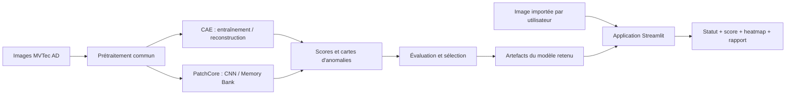

# IndustrialDefect AI

**Détection et localisation d'anomalies visuelles sur des produits industriels par Deep Learning**

> Projet académique — Module **Deep Learning**, 5IIR–DDSI  
> Équipe : **3 étudiants** · Développement planifié sur **7 jours** · Dépôt de référence : [MRdrissi/industrial-defect-ai](https://github.com/MRdrissi/industrial-defect-ai)

## 1. Présentation du projet

Dans une chaîne de fabrication, l'inspection visuelle permet de repérer des défauts sur des produits : fissures, cassures, rayures, contaminations ou déformations. Une inspection manuelle répétitive peut être lente, variable d'un opérateur à l'autre et difficile à généraliser à de grandes quantités de pièces.

**IndustrialDefect AI** vise à développer un prototype d'aide au contrôle qualité capable d'analyser une image d'un produit industriel, de **signaler une anomalie éventuelle** et d'en **localiser les régions suspectes**. L'application doit également présenter un résultat compréhensible et un rapport d'inspection simple.

Le projet repose sur la **détection d'anomalies visuelles industrielles** (*Industrial Visual Anomaly Detection*). Son but n'est pas, dans la première version, d'identifier précisément la nature de chaque défaut, ni de remplacer une procédure de certification industrielle.

### Problématique scientifique

> **Comment apprendre les caractéristiques visuelles de pièces industrielles conformes afin de détecter et localiser des défauts non nécessairement observés pendant l'apprentissage, tout en limitant les fausses alertes ?**

La difficulté vient du fait qu'en production, les exemples de produits conformes sont souvent plus nombreux que les exemples de chaque défaut possible. Nous privilégions donc une **approche centrée sur les images normales**, plutôt qu'un classificateur supervisé exigeant des exemples annotés de toutes les classes de défauts.

## 2. Objectifs

### Objectifs scientifiques

- Comprendre la différence entre **classification supervisée**, **détection d'objets** et **détection d'anomalies**.
- Étudier et comparer **deux méthodes basées sur des CNN** : un **Convolutional Autoencoder** et **PatchCore**.
- Préparer des données visuelles, entraîner ou configurer les modèles, analyser leurs scores et leurs cartes d'anomalies.
- Évaluer séparément la **détection au niveau de l'image** et la **localisation au niveau des pixels**.
- Documenter le protocole expérimental, les hyperparamètres, les résultats et les limites.

### Objectifs applicatifs

- Importer une image de produit depuis une interface web.
- Produire un **score d'anomalie** et une décision **normal / suspect** selon un seuil défini.
- Afficher une **carte thermique** ou une superposition localisant les zones suspectes.
- Présenter un **résultat d'inspection** et permettre un export simple des informations utiles.

**À noter :** un score d'anomalie n'est **pas**, sans calibration appropriée, une probabilité d'être défectueux. Une carte thermique est une indication de régions suspectes, pas une preuve certaine de défaut.

## 3. Périmètre et priorités

Le délai est court : nous privilégions **un pipeline complet, fiable et documenté**, avant toute extension fonctionnelle.

| Niveau | Fonctionnalité | Décision |
|---|---|---|
| **MVP** | Catégorie industrielle `bottle` | Priorité absolue |
| **MVP** | Détection d'images normales/anormales | Priorité absolue |
| **MVP** | Visualisation des régions suspectes | Priorité absolue |
| **MVP** | Comparaison Autoencoder / PatchCore | Priorité scientifique |
| **MVP** | Évaluation quantitative et qualitative | Priorité scientifique |
| **MVP** | Import d'image et résultat d'inspection | Priorité applicative |
| **MVP** | Export d'un rapport simple, par exemple CSV | Prévu |
| **Extension** | Deuxième catégorie, par exemple `transistor` | Si le MVP est stabilisé |
| **Extension** | Caméra, traitement vidéo temps réel | Hors périmètre initial |
| **Extension** | Reconnaissance précise du type de défaut | Hors périmètre initial |
| **Extension** | Backend Spring Boot, microservices et déploiement avancé | Évolution possible du portfolio |

Une nouvelle catégorie nécessitera en principe une **adaptation ou une préparation de modèle propre à cette catégorie** ; un modèle appris sur les bouteilles ne doit pas être supposé valide sur les transistors.

## 4. Jeu de données : MVTec AD

Le jeu de données envisagé est **MVTec Anomaly Detection (MVTec AD)**, conçu pour l'évaluation de méthodes de détection et de localisation d'anomalies en inspection industrielle. Il comporte **15 catégories** d'objets ou de textures.

**Catégorie de départ :** `bottle`.

La structure habituelle d'une catégorie comprend :

- `train/good/` : images **normales** utilisées pour l'apprentissage ;
- `test/good/` et `test/<type_defaut>/` : images normales et anormales pour l'évaluation ;
- `ground_truth/<type_defaut>/` : **masques des régions anormales** pour mesurer la localisation.

**Protocole de données :** réserver une partie des images normales à la validation, documenter le découpage, déterminer les seuils sans consulter les résultats du test final, puis évaluer sur un test tenu à l'écart. Les masques de test servent à **évaluer** la localisation, pas à entraîner secrètement les méthodes dites *one-class*.

- [Page officielle MVTec AD](https://www.mvtec.com/research-teaching/datasets/mvtec-ad)
- **Licence du dataset :** CC BY-NC-SA 4.0 (vérifier les conditions avant toute redistribution ou publication de données).

> Le téléchargement, la préparation et l'analyse détaillée du dataset appartiennent à l'**Epic 02**. Ne pas ajouter les images brutes au dépôt GitHub.

## 5. Méthodes Deep Learning prévues

| Aspect | **Convolutional Autoencoder (CAE)** | **PatchCore** |
|---|---|---|
| Principe | Reconstruire les images normales | Comparer les *patch features* à une mémoire de caractéristiques normales |
| Réseau | Encodeur + décodeur convolutionnels | Extracteur CNN pré-entraîné + *Memory Bank* |
| Apprentissage | Optimisation des poids par rétropropagation | Extraction et mémorisation de caractéristiques, sans entraînement complet du CNN dans la configuration usuelle |
| Score | Erreur de reconstruction | Distance à des représentations normales proches |
| Localisation | Carte d'erreur de reconstruction | Carte des distances/anomalies par région |
| Risque principal | Reconstruire aussi certains défauts ; faux positifs de reconstruction | Coût mémoire/calcul et sensibilité au domaine |

**Pourquoi les comparer ?** Ces méthodes incarnent deux hypothèses différentes sur la normalité visuelle. L'objectif n'est pas d'affirmer à l'avance laquelle gagnera, mais de l'établir expérimentalement.

### Critères d'évaluation envisagés

- **Image-AUROC** : capacité de discrimination entre images normales et anormales ;
- **Precision, Recall, F1** après choix documenté d'un seuil ;
- **Pixel-AUROC** pour la localisation ;
- Exemples qualitatifs de **bonnes et mauvaises détections**, temps d'inférence et ressources nécessaires.

Les résultats numériques ne seront ajoutés qu'après exécution réelle des expériences.

## 6. Vue d'ensemble de l'architecture cible



**Choix technologiques prévus :** Python, PyTorch, Anomalib (pour PatchCore si sa compatibilité est confirmée), OpenCV/Pillow, scikit-learn, Matplotlib et Streamlit. Les versions et dépendances du **pipeline final** restent à fixer après tests ; **aucun `requirements.txt` complet validé n'est encore publié**.

## 7. Infrastructure et répartition des rôles

Notre équipe comprend **3 membres**, avec **2 contributeurs techniques principaux**. La répartition définitive sera formalisée sur Jira selon les compétences et disponibilités. Le responsable technique supervise les décisions scientifiques, l'intégration et les critères de validation ; les autres membres contribuent à l'implémentation, à la préparation des données, aux tests et à la documentation selon les tâches attribuées.

| Outil | Responsabilité |
|---|---|
| **IntelliJ IDEA Ultimate** | Développement local Python, notebooks et Git |
| **Git / GitHub** | Source de vérité du code, documentation et historique des contributions |
| **Kaggle Notebooks** | Environnement principal pour les expériences nécessitant un GPU |
| **Google Colab** | Solution de secours éventuelle, **non encore qualifiée** |
| **Kaggle Outputs** | Conservation des modèles/checkpoints et artefacts volumineux |
| **Jira** | Epics, User Stories, responsables, priorités et Definition of Done |

**Principe :** les sessions GPU exécutent le code ; **GitHub** conserve les sources versionnées et la traçabilité ; les **artefacts volumineux** restent dans un stockage persistant distinct.

L'infrastructure déjà testée comprend : Python **3.12.6** dans un `.venv` Windows, Jupyter fonctionnel dans IntelliJ, accès Kaggle à **2 GPU Tesla T4 lors du test**, sauvegarde d'un `state_dict` et restauration sur CPU dans un second notebook. Les ressources Kaggle sont soumises à disponibilité et quotas ; les versions de Python et PyTorch sur Kaggle peuvent changer d'une session à l'autre.

## 8. Organisation du dépôt

```text
industrial-defect-ai/
├── README.md
├── .gitignore
├── notebooks/
│   ├── 00_environment_check.ipynb
│   ├── 00-kaggle-gpu-check.ipynb
│   └── 01-artifact-restore-check.ipynb
├── src/
│   ├── data/
│   ├── models/
│   ├── evaluation/
│   └── inference/
├── app/
├── experiments/
│   ├── README.md
│   ├── templates/experiment_template.json
│   └── runs/             # métadonnées des expériences futures
└── docs/
    └── EPIC-01-infrastructure.md
```

Les dossiers `src/`, `app/` et certaines parties de `experiments/` sont **préparés**, pas encore des fonctionnalités implémentées. Les dossiers `.venv/`, `.idea/`, les données brutes et les poids des modèles sont **ignorés par Git**.

## 9. Méthode de travail Git et GitHub

Nous utilisons une **branche partagée par Epic**, comme dans notre projet SahlPay Data Platform :

- `main` : version intégrée, vérifiée et stable ;
- `epic/01-infrastructure` : environnement de travail, GitHub/Kaggle, traçabilité ;
- `epic/02-data-preparation` : analyse et préparation des données ;
- `epic/03-deep-learning` : modèles et expérimentations ;
- `epic/04-application` : interface, intégration et validation.

Les trois dernières branches sont **prévisionnelles** et seront créées lorsqu'elles seront nécessaires.

Workflow standard d'une **User Story** sur sa branche Epic :

```powershell
git switch epic/01-infrastructure
git pull --ff-only origin epic/01-infrastructure
# Développer, tester, documenter
git status
git diff
git add <chemins-des-fichiers>
git commit -m "feat(US-XX): decrire la realisation"
git pull --rebase origin epic/01-infrastructure
git push origin epic/01-infrastructure
git status
```

Adapter **le nom de branche** et **l'identifiant de l'US**. Sur une branche partagée, prévenir les autres avant de modifier un même notebook ; effectuer le rebase avec un arbre de travail propre, résoudre les conflits et **ne pas forcer le push**. Chaque Epic rejoint `main` **après revue et validation collective via Pull Request**.

**Règle de fin de tâche (DoD) :** travail implémenté, testé, documenté, résultats vérifiables, commit identifiable et publication sur la bonne branche. Les expériences doivent en outre renseigner leurs métadonnées.

## 10. Suivi scientifique des expériences

Chaque expérience importante reçoit un identifiant unique (`EXP-001`, `EXP-002`, etc.) et, à terme, un fichier dans `experiments/runs/` issu du modèle `experiments/templates/experiment_template.json`.

Les informations attendues sont : architecture, paramètres, catégorie/découpage des données, versions d'environnement, **commit réellement exécuté**, métriques, emplacement des poids et **URL de la version Kaggle**. Le protocole est décrit dans [experiments/README.md](experiments/README.md).

> Un fichier `.ipynb` peut contenir **code, sorties et métadonnées**. Les sorties essentielles peuvent être conservées, mais ne remplacent pas des métriques structurées et des liens vers les modèles. **La synchronisation Kaggle → GitHub n'est pas automatique dans notre workflow actuel** : exporter le notebook, vérifier les modifications, committer puis pousser sur la branche Epic.

## 11. Roadmap : Epics et documentation associée

**Chaque Epic possède ou possédera son propre fichier Markdown dans `docs/`** : ce document décrit son objectif, ses choix, ses User Stories, son environnement, ses validations, ses risques et les procédures pour reprendre le travail.

| Epic | Objectif | Document | État |
|---|---|---|---|
| **EPIC-01 — Infrastructure & Collaboration** | IntelliJ, Git, GitHub, Kaggle, sauvegarde et traçabilité | [docs/EPIC-01-infrastructure.md](docs/EPIC-01-infrastructure.md) | Tests validés ; **PR vers `main` à réaliser** |
| **EPIC-02 — Data Exploration & Preparation** | Comprendre MVTec AD, préparer les splits et le prétraitement | `docs/EPIC-02-data-preparation.md` | À venir |
| **EPIC-03 — Deep Learning & Experimentation** | CAE, PatchCore, entraînement, évaluation et comparaison | `docs/EPIC-03-deep-learning.md` | À venir |
| **EPIC-04 — Application & Validation** | Inférence, interface Streamlit, tests et démonstration | `docs/EPIC-04-application.md` | À venir |

### Plan de travail indicatif (7 jours)

| Jour | Cible principale |
|---|---|
| J1 | Infrastructure de collaboration et GPU |
| J2 | Étude des données, premiers tests de modèle |
| J3 | Deuxième approche, entraînement et sauvegarde |
| J4 | Évaluation, réglages et analyse des erreurs |
| J5 | Intégration à l'application |
| J6 | Tests de bout en bout et stabilisation |
| J7 | Rapport, supports et démonstration |

Ce calendrier est une **intention de pilotage**, pas une promesse de fonctionnalités terminées. Une extension n'est entreprise que lorsque le MVP fonctionne de bout en bout.

## 12. Reprendre le projet

Pour installer l'environnement local, comprendre le workflow complet GitHub ↔ Kaggle, importer/exporter les notebooks et restaurer les modèles, lire **[EPIC-01 — Guide d'infrastructure et d'intégration d'un membre](docs/EPIC-01-infrastructure.md)**.

Premiers pas sur Windows (PowerShell ; Python 3.12 requis) :

```powershell
git clone https://github.com/MRdrissi/industrial-defect-ai.git
cd industrial-defect-ai
git switch main                 # ou la branche Epic attribuée
py -3.12 -m venv .venv
.\.venv\Scripts\python.exe --version
.\.venv\Scripts\python.exe -m pip install ipykernel
```

L'installation des **dépendances Deep Learning** sera documentée et figée après validation ; ne pas supposer que la seule présence du notebook entraîne l'installation de PyTorch dans le `.venv` local.

## 13. Qualité, limites et livrables

La qualité du projet sera appréciée par : une **démonstration exécutable**, un protocole scientifique sans fuite de données, des résultats reproductibles, une comparaison argumentée des deux méthodes, des tests, une documentation compréhensible et un historique Git lisible.

Limites connues : premier périmètre restreint à une catégorie ; performances non garanties hors des conditions de MVTec AD ; faux positifs/faux négatifs possibles ; absence de validation en environnement industriel réel ; GPU cloud soumis à quota.

**Livrables envisagés :** dépôt Git, notebooks et scripts d'entraînement, configurations et résultats d'évaluation, application de démonstration, rapport écrit et présentation orale.

## 14. Références

- [MVTec AD — dataset et conditions d'utilisation](https://www.mvtec.com/research-teaching/datasets/mvtec-ad)
- [PyTorch — sauvegarde et chargement des modèles](https://docs.pytorch.org/tutorials/beginner/saving_loading_models.html)
- [Kaggle — documentation des notebooks](https://www.kaggle.com/docs/notebooks)
- [GitHub — fonctionnement des Pull Requests](https://docs.github.com/en/pull-requests/get-started/about-pull-requests)
- [JetBrains — support des notebooks dans IntelliJ IDEA](https://www.jetbrains.com/help/idea/jupyter-notebook-support.html)

---

**État documentaire au 7 novembre 2026 :** l'Epic 01 est testé et publié sur sa branche ; sa documentation est préparée **avant** la Pull Request vers `main`. Les modèles industriels, les mesures d'évaluation et l'application constituent les étapes suivantes.
