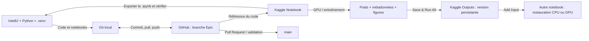

# EPIC-01 — Infrastructure, collaboration et reproductibilité

**Projet :** IndustrialDefect AI  
**Branche :** `epic/01-infrastructure`  
**État :** configuration et tests réalisés ; **documentation à intégrer, revue et Pull Request vers `main` encore à effectuer**  
**Public :** tous les membres de l'équipe, y compris une personne rejoignant le projet sans connaître l'environnement initial.

> **Objectif de cet Epic :** permettre à l'équipe de coder localement, d'exécuter des expérimentations sur le GPU Kaggle et de retrouver leurs notebooks, résultats, configurations et poids après interruption des sessions, tout en conservant un historique Git lisible.

---

## 1. Pourquoi cette infrastructure ?

Nous ne disposons pas de GPU dédié sur nos machines de développement. Un entraînement Deep Learning doit pouvoir s'exécuter sur un GPU cloud **sans perdre le lien** avec le code qui l'a produit ni avec les résultats collectés.

Trois besoins doivent être satisfaits :

1. **Collaborer** sur un dépôt GitHub unique à trois, par branches Epic et User Stories.
2. **Calculer** sur Kaggle, sans dépendance permanente à une session GPU ou à un ordinateur personnel.
3. **Tracer et reproduire** chaque expérience : code, configuration, dataset/split, métriques et artefacts.



**Point de vigilance :** ce schéma représente le **workflow choisi**, pas une automatisation. Dans notre mise en place actuelle, Kaggle **ne pousse pas automatiquement** les modifications vers GitHub ; l'export et les commandes Git restent explicites.

## 2. Périmètre et critères de réussite

### Inclus

- Projet Python dans **IntelliJ IDEA Ultimate**, environnement virtuel propre.
- Support **Jupyter** et exécution de notebooks localement.
- Git initialisé, dépôt GitHub partagé, branche `epic/01-infrastructure` publiée.
- Vérification de l'accès GPU et du calcul PyTorch sur Kaggle.
- Sauvegarde d'un modèle de test en **`state_dict`** et de ses métadonnées.
- Restauration de ce modèle dans un **second notebook**, sur CPU et sans réentraînement.
- Convention et template **JSON de suivi des expériences**.
- Documentation pour l'intégration des coéquipiers et les opérations courantes.

### Hors périmètre de cet Epic

Télécharger MVTec AD, entraîner le véritable Autoencoder/PatchCore, développer Streamlit et mesurer les métriques industrielles : ces tâches appartiennent aux Epics suivants.

### Definition of Done de l'Epic

- [x] Python et Jupyter fonctionnent localement.
- [x] Dépôt distant GitHub et branche Epic opérationnels.
- [x] Un calcul PyTorch s'exécute sur GPU Kaggle.
- [x] Un `state_dict` et un JSON sont conservés en outputs Kaggle.
- [x] Les poids sont rechargés dans un second notebook sur CPU, avec résultat vérifié.
- [x] Les notebooks d'infrastructure sont versionnés sur la branche Epic.
- [x] Un protocole et un template d'expérience existent.
- [ ] Documentation générale et guide de cet Epic intégrés au dépôt.
- [ ] Revue des modifications et Pull Request **`epic/01-infrastructure` → `main`** validée.

Les cases finales seront cochées **uniquement après** la réalisation des opérations correspondantes.

---

## 3. État vérifié de l'environnement

### 3.1. Poste Windows (configuration de référence)

| Élément | Configuration effectivement testée |
|---|---|
| IDE | IntelliJ IDEA Ultimate |
| Plugins | Python (JetBrains), Jupyter |
| Python local | **3.12.6** |
| `pip` local | **26.0.1** lors du test |
| Environnement virtuel | `C:\Projects\industrial-defect-ai\.venv` |
| Terminal | PowerShell |
| Git | **2.48.1.windows.1** |
| Kernel local | `ipykernel` disponible ; gestion Jupyter par l'IDE |
| Dépôt | `https://github.com/MRdrissi/industrial-defect-ai.git` |

La machine possède également Python 3.13, **mais le projet utilise explicitement Python 3.12**. Le plugin Jupyter d'IntelliJ et `ipykernel` ont suffi à exécuter le premier notebook : il n'a pas été nécessaire d'installer un serveur Jupyter autonome complet.

### 3.2. Kaggle (configuration observée lors des tests)

- Le GPU était accessible : `torch.cuda.is_available() == True`.
- **2 × NVIDIA Tesla T4** étaient visibles lors de la session testée.
- Le calcul s'est exécuté sur **`cuda:0`** : voir deux GPU ne signifie pas qu'ils sont exploités ensemble.
- Un réseau neuronal PyTorch de test a été entraîné puis sérialisé.
- Les versions de Python/PyTorch dans les environnements Kaggle **peuvent différer de celles du poste local et évoluer**. Elles doivent être enregistrées à chaque expérience, pas supposées fixes.
- Les quotas et disponibilités GPU de Kaggle sont variables ; **Colab est une option de secours, pas encore testée dans cet Epic**.

### 3.3. Dépendances : installées vs prévues

| Dépendance | Local | Kaggle | Observation |
|---|---|---|---|
| Python | 3.12.6 validé | Version fournie par la session | Éviter les hypothèses de compatibilité implicites |
| `ipykernel` / IPython | Installés, notebook testé | Kernel intégré | Suffisants pour l'essai Jupyter local |
| PyTorch | **Non requis pour les notebooks locaux déjà testés** | Disponible, GPU testé | Installer localement seulement si nécessaire |
| `jupyter_server`, `jupyterlab`, `notebook` | Pas indispensables pour le mode IntelliJ testé | Géré par Kaggle | Ne pas installer sans besoin réel |
| Anomalib | **Non testé** | **Non testé** | Compatibilité à qualifier pendant l'Epic DL |
| Streamlit | **Non installé/validé** | Non nécessaire aux tests d'infrastructure | Sera abordé dans l'Epic Application |
| `requirements.txt` complet | **Non finalisé** | **Non finalisé** | À fixer après validation des versions nécessaires |

**Ne pas déduire de cette liste que tout PyTorch/Anomalib est déjà opérationnel dans le `.venv` local.** Le GPU et l'entraînement ont été testés sur **Kaggle**.

---

## 4. Installation locale : guide pour un nouveau membre

### Prérequis

- Un ordinateur avec Windows et PowerShell (ou adaptation des commandes pour Linux/macOS).
- Git installé et accessible dans le terminal.
- **Python 3.12** installé, avec le lanceur `py` sur Windows.
- IntelliJ IDEA Ultimate avec plugins Python et Jupyter, **ou** un IDE compatible Python/Jupyter.
- Une invitation acceptée au dépôt GitHub s'il est encore privé.
- Un **compte Kaggle personnel** pour les tâches nécessitant un GPU.

### 4.1. Cloner le dépôt

```powershell
cd C:\Projects
git clone https://github.com/MRdrissi/industrial-defect-ai.git
cd industrial-defect-ai

git branch -a
git switch epic/01-infrastructure    # pendant le travail de cet Epic
git pull --ff-only origin epic/01-infrastructure
```

Une fois la Pull Request de l'Epic 01 fusionnée, un nouveau membre peut commencer depuis `main`, puis basculer sur **la branche Epic qui lui est attribuée**. Ne pas utiliser une branche archivée pour développer une nouvelle fonctionnalité sans raison.

### 4.2. Créer l'environnement virtuel

```powershell
py -3.12 -m venv .venv
.\.venv\Scripts\python.exe --version
.\.venv\Scripts\python.exe -m pip --version
.\.venv\Scripts\python.exe -m pip install ipykernel
```

Activer l'environnement si souhaité :

```powershell
.\.venv\Scripts\Activate.ps1
```

En cas de restriction de la politique d'exécution PowerShell, **ne pas désactiver globalement la sécurité** ; utiliser directement `\.venv\Scripts\python.exe` pour les commandes, ou suivre les règles du poste.

### 4.3. Configurer IntelliJ

1. Ouvrir le dossier du dépôt comme projet existant.
2. Vérifier le plugin **Python** et le support **Jupyter**.
3. Choisir comme interpréteur : `<racine>\.venv\Scripts\python.exe`.
4. Ouvrir `notebooks/00_environment_check.ipynb`.
5. Exécuter la cellule : elle doit afficher le Python du projet et son chemin `.venv`.

**Rappel :** une cellule exécutée localement utilise la **machine locale**, pas le GPU Kaggle. Pour les calculs GPU, ouvrir le notebook sur Kaggle et contrôler l'accélérateur.

---

## 5. Où se trouvent les fichiers ?

```text
industrial-defect-ai/
├── README.md                        # Présentation métier, scientifique et roadmap
├── .gitignore                       # Exclusion des données, poids, caches, .venv, .idea
├── notebooks/
│   ├── 00_environment_check.ipynb   # Vérification Python / interpréteur local
│   ├── 00-kaggle-gpu-check.ipynb     # CUDA + entraînement et sérialisation test
│   └── 01-artifact-restore-check.ipynb  # Restauration sur CPU depuis Kaggle Input
├── experiments/
│   ├── README.md                    # Protocole de suivi des expériences
│   ├── templates/
│   │   └── experiment_template.json # Modèle JSON
│   └── runs/                        # Futures métadonnées EXP-XXX
├── src/
│   ├── data/
│   ├── models/
│   ├── evaluation/
│   └── inference/
├── app/
└── docs/
    └── EPIC-01-infrastructure.md    # Présent guide
```

**Git versionne des fichiers, pas les dossiers vides.** Un `.gitkeep` permet de conserver un dossier sans code. Les modèles `*.pt`, `*.pth`, les datasets et les répertoires `.venv/`, `.idea/` sont exclus du dépôt. Ne jamais publier de mots de passe, clés API, jetons Kaggle ou informations sensibles dans des notebooks et leurs sorties.

---

## 6. Travailler sur GitHub : branche Epic partagée

### Convention

- Branche stable : **`main`**.
- Une branche partagée par Epic : **`epic/01-infrastructure`**, puis `epic/02-data-preparation`, etc.
- Chaque User Story est liée à une tâche Jira et à des commits traçables.
- Exemples de commits : `feat(US-02): add dataset checks`, `test(infra): validate GPU restoration`, `docs(epic-01): document Kaggle workflow`.
- **Pull Request vers `main` uniquement après validation collective**.

### Début d'une session (aucune modification non enregistrée)

```powershell
git switch epic/01-infrastructure
git pull --ff-only origin epic/01-infrastructure
git status
```

Si `git pull --ff-only` échoue parce que la branche locale et la branche distante ont divergé, **ne pas forcer**. Examiner les commits locaux et distants ; une intégration par rebase peut être nécessaire après sauvegarde des changements.

### Fin d'une User Story

```powershell
git status
git diff
git add notebooks/00-kaggle-gpu-check.ipynb   # exemple : ajouter seulement les fichiers concernés
git diff --cached --stat
git diff --cached --check
git commit -m "test(US-XX): describe validated experiment"
git pull --rebase origin epic/01-infrastructure
git push origin epic/01-infrastructure
git status
```

**Précautions pour les branches communes :**

- Ne pas modifier simultanément le **même notebook**. Désigner un responsable par fichier pendant un travail donné.
- Un notebook `.ipynb` est du **JSON** ; les exports Kaggle peuvent tenir sur **une seule ligne**, ce qui rend `git diff` peu lisible. Utiliser l'aperçu IntelliJ/GitHub et les métadonnées pour les revues.
- Effectuer `pull --rebase` sur un arbre de travail propre ; résoudre les conflits, puis continuer le rebase. **Pas de `git push --force` sur une branche Epic partagée.**
- Ne pas confondre le **Save Version** de Kaggle avec un commit Git : ce sont deux historiques distincts.
- Ne jamais mettre `.venv/`, dataset complet, modèle volumineux ou secrets dans `git add`.

### Examiner les cellules et les sorties sauvegardées d'un notebook

```powershell
$nb = Get-Content 'notebooks/00-kaggle-gpu-check.ipynb' -Raw | ConvertFrom-Json
foreach ($cell in $nb.cells) {
    if ($cell.cell_type -eq 'code') {
        Write-Host 'Execution:' $cell.execution_count '| Outputs:' $cell.outputs.Count
    }
}
```

Lors des essais, le notebook GPU comptait **5 cellules de code avec leurs sorties**, le notebook local **1 cellule** et le notebook de restauration **2 cellules**, chacune avec une sortie. Le rendu peut varier entre Kaggle, GitHub et IntelliJ ; c'est le contenu JSON qui fait foi.

---

## 7. Exécuter les expériences sur Kaggle

### 7.1. Créer une session et vérifier le GPU

1. Se connecter à Kaggle avec **son propre compte**.
2. Ouvrir/créer un notebook à partir du code versionné pour l'expérience.
3. Dans les paramètres, sélectionner un **accélérateur GPU** disponible.
4. Exécuter un test :

```python
import torch
print('PyTorch:', torch.__version__)
print('CUDA disponible:', torch.cuda.is_available())
print('Nombre de GPU:', torch.cuda.device_count())
if torch.cuda.is_available():
    print('GPU actif possible:', torch.cuda.get_device_name(0))
```

Si `CUDA disponible: False`, vérifier la sélection de l'accélérateur, la disponibilité de la session et le quota. **Ne pas démarrer un entraînement long sans ce contrôle.**

### 7.2. Relation entre code local et notebook Kaggle

**Workflow actuellement validé :**

1. Écrire/adapter un notebook `.ipynb` (localement ou sur Kaggle), en gardant la branche Epic comme référence.
2. Sur Kaggle, exécuter les cellules avec le dataset attaché en **Input**.
3. Sauvegarder une version **Save & Run All (Commit)** pour obtenir des outputs persistants d'une exécution propre.
4. Télécharger/exporter le notebook **après** la dernière modification ; copier le fichier dans `notebooks/`.
5. Examiner `git status` et `git diff`, créer le commit puis pousser sur **la branche Epic**, pas sur `main`.
6. Reporter les métriques et la version Kaggle dans les métadonnées d'expérience.

L'intégration Kaggle–GitHub peut être explorée ultérieurement, mais **elle n'est pas le mécanisme officiel validé pour les branches partagées**. Ne pas supposer un push automatique, surtout vers `main`.

### 7.3. Préserver le temps GPU

- Utiliser le **CPU** pour explorer des fichiers, documenter, tester les imports et restaurer un petit modèle.
- Réserver le GPU aux entraînements, à l'extraction de caractéristiques lourde et aux évaluations nécessitant son accélération.
- Sauvegarder régulièrement les résultats importants ; les sessions et quotas ne sont pas permanents.
- Pour **Save & Run All**, choisir l'accélérateur nécessaire **pour cette session** si la plateforme le permet.

---

## 8. Sauvegarde, persistance et restauration des modèles

### 8.1. Ce qui a été testé

Le notebook `00-kaggle-gpu-check.ipynb` a :

1. Créé un petit réseau PyTorch `Linear(4,16) → ReLU → Linear(16,2)`.
2. Effectué une optimisation sur données **synthétiques** avec un GPU Kaggle.
3. Enregistré les **poids** sous `tiny_model_state_dict.pt`.
4. Enregistré un fichier `experiment_info.json` (versions, configuration et prédiction de référence).
5. Rechargé les poids dans une nouvelle instance et vérifié les prédictions.

Les fichiers ont été déposés dans :

```text
/kaggle/working/infra_artifacts/
├── tiny_model_state_dict.pt
└── experiment_info.json
```

Après **Save & Run All**, ces fichiers ont été visibles dans l'onglet **Output** d'une version Kaggle.

### 8.2. Modèle PyTorch : pattern général

```python
from pathlib import Path
import torch

output_dir = Path('/kaggle/working/infra_artifacts')
output_dir.mkdir(parents=True, exist_ok=True)

torch.save(model.state_dict(), output_dir / 'tiny_model_state_dict.pt')
```

Il faut **aussi conserver la définition de l'architecture**, les prétraitements et les métadonnées. Le `state_dict` seul ne permet pas de reconstruire automatiquement l'architecture du réseau.

### 8.3. Restauration dans un autre notebook, sans GPU

1. Créer le notebook `01_artifact_restore_check` (ou ouvrir sa copie).
2. Choisir **Accelerator: None** pour ce test.
3. Dans **Input → Add Input**, attacher les **outputs versionnés** du notebook précédent.
4. Repérer le chemin du checkpoint sous `/kaggle/input/notebooks/.../infra_artifacts/`.
5. Recréer **la même architecture**, puis charger les poids sur CPU :

```python
from pathlib import Path
import torch

paths = list(Path('/kaggle/input').rglob('tiny_model_state_dict.pt'))
assert len(paths) == 1, f'Checkpoints trouvés : {len(paths)}'

# build_model() doit reproduire l'architecture enregistrée
restored_model = build_model()
weights = torch.load(paths[0], map_location='cpu', weights_only=True)
restored_model.load_state_dict(weights)
restored_model.eval()
```

Le notebook réel compare ensuite une sortie de référence du JSON avec la nouvelle sortie. Lors du test, **`Predictions match: True`**, **`Execution device: cpu`** et **`SUCCESS: Model restored without retraining!`** ont été obtenus.

**Limite :** ce test démontre le mécanisme pour un petit réseau PyTorch, pas encore la portabilité des véritables modèles industriels. Pour PatchCore, il faudra préserver non seulement la configuration du CNN, mais également les **données de la Memory Bank** et toute information indispensable à l'inférence.

### 8.4. Où sauvegarder quoi ?

| Élément | Stockage de référence |
|---|---|
| Code `.py`, notebooks `.ipynb`, docs | GitHub (branche Epic) |
| Configurations JSON, métriques CSV/JSON, figures sélectionnées | GitHub |
| Images MVTec AD brutes | Source externe/Kaggle Input, **pas GitHub** |
| `.pt`, `.pth`, mémoire PatchCore et checkpoints lourds | Kaggle Outputs + sauvegarde externe si nécessaire |
| Fichiers temporaires de session | `/kaggle/working/` ; **persistants uniquement via sauvegarde correcte de version** |

**Règle :** un fichier présent dans `/kaggle/working/` pendant une session interactive **n'est pas, à lui seul, une preuve de sauvegarde durable**. Il faut le retrouver dans les **outputs d'une version enregistrée**, puis tester son rechargement.

---

## 9. Traçabilité scientifique des expériences

Le protocole se trouve dans [`experiments/README.md`](../experiments/README.md) ; le modèle est [`experiments/templates/experiment_template.json`](../experiments/templates/experiment_template.json).

### Convention des identifiants

- `EXP-001`, `EXP-002`, etc. : **une expérience documentée**.
- Un fichier par expérience : `experiments/runs/EXP-001.json`.
- Le JSON doit renseigner **le vrai commit** du code exécuté, pas le commit créé après coup pour publier des résultats modifiés.

### Champs à compléter

| Catégorie | Exemples |
|---|---|
| Identification | ID, modèle, catégorie `bottle` |
| Données | Version du dataset, manifeste des splits, prétraitements |
| Environnement | Plateforme, Python, PyTorch, GPU |
| Entraînement | Epochs, batch size, learning rate, image size, seed, si applicable |
| Évaluation | Image-AUROC, Precision, Recall, F1, Pixel-AUROC |
| Artefacts | Chemin du modèle, URL de version Kaggle |
| Analyse | Notes, limites, erreur rencontrée, interprétation |

**Important :** certains champs du template sont inapplicables à certaines méthodes ; pour PatchCore, par exemple, `epochs` et `learning_rate` peuvent rester à `null` si aucun entraînement par gradient n'a été effectué. Documenter plutôt les paramètres pertinents de l'extracteur et de la mémoire.

**Statut :** la **structure JSON et la procédure sont en place**, mais leur génération automatique et leur utilisation avec les véritables modèles restent à réaliser.

### Contrôle de reproductibilité avant la publication d'un résultat

- Le notebook exécute le **code associé au commit déclaré** (sinon documenter l'écart).
- Le dataset, la catégorie et les splits sont décrits.
- Les versions de Python, PyTorch et des bibliothèques clés sont notées.
- Les configurations et métriques sont sauvegardées.
- Le lien pointe vers la **bonne version Kaggle**, pas seulement vers une page générale.
- Les poids peuvent être récupérés ; le modèle peut être rechargé et testé.
- Les résultats de test final n'ont pas été utilisés pour régler clandestinement le modèle.

---

## 10. Organisation de l'équipe et Jira

Trois étudiants participent au projet, avec deux contributeurs principaux pour les tâches Deep Learning/infrastructure. Le troisième membre peut notamment prendre en charge des **tâches limitées, vérifiables et utiles**, telles que le contrôle des notebooks, la vérification des sorties, la documentation et les tests fonctionnels.

Chaque User Story Jira doit préciser : **objectif**, **responsable**, **branche Epic**, **livrable**, **critères d'acceptation**, **Definition of Done**, **référence commit ou Pull Request**.

### Sous-activités effectivement réalisées dans cet Epic

| Activité | Preuve / résultat |
|---|---|
| Projet Python et notebooks locaux | `00_environment_check.ipynb` exécuté dans `.venv` |
| Initialisation Git et premier commit | `059e156` |
| Premier notebook Kaggle versionné | `3826e0a` |
| Persistance et restauration indépendantes | `4eef5a5` |
| Template et protocole d'expérience | `24544f5` |
| Documentation de l'Epic | Présente édition ; commit à venir |

**La validation Jira d'une US exige des tests et une documentation proportionnée à son objectif**, et pas seulement un commit.

---

## 11. Risques et procédures de secours

| Risque | Signal | Réponse recommandée |
|---|---|---|
| GPU indisponible / quota épuisé | CUDA `False`, accélérateur non accessible | Vérifier le quota, réessayer plus tard ; basculer sur CPU pour tâches légères ; Colab en secours après test |
| Session Kaggle interrompue | Variables et fichiers de session disparus | Utiliser une **version sauvegardée** et ses outputs ; ne pas supposer que le brouillon est persistant |
| Checkpoint introuvable | Aucun `.pt` sous `/kaggle/input/` | Vérifier **Add Input**, le notebook source, la version et l'arborescence |
| Erreur de restauration | Incompatibilité de tailles ou clés de poids | Recréer **la bonne architecture**, vérifier version du code et config |
| Résultats CPU/GPU légèrement différents | Différences numériques | Comparer avec `torch.allclose` et tolérances raisonnables, enregistrer les versions |
| Notebook de GitHub semble sans sorties | Rendu différent entre outils | Lire le JSON `.ipynb` et vérifier `execution_count` / `outputs` |
| `git add` ne trouve pas le fichier | `pathspec did not match` | Vérifier le **nom réel** (`-` vs `_`) avec `git status` |
| Conflit Git sur `.ipynb` | Fichier JSON difficile à fusionner | Coordonner un responsable par notebook ; revue du diff et résolution manuelle prudente |
| Fuite de fichiers volumineux | Dataset ou `.pt` apparaît dans `git status` | Vérifier `.gitignore` et désindexer avant commit |
| Versions Python différentes | Import/installation impossible | Documenter l'environnement ; valider les dépendances **par environnement**, ne pas supposer l'identité des versions |

### Vérifier l'état du dépôt après une interruption

```powershell
git status
git branch --show-current
git remote -v
git log --oneline -5
```

Si des changements locaux existent, les inspecter et les sauvegarder **avant** un changement de branche ou un pull. Ne pas lancer `git reset --hard` pour « tout réparer » sans comprendre ce qui serait effacé.

---

## 12. Clôturer l'Epic et préparer la Pull Request

**Ne pas fusionner tant que ce guide et le README général ne sont pas publiés et revus.**

### Contrôles locaux

```powershell
git switch epic/01-infrastructure
git status
git diff
git add README.md docs/EPIC-01-infrastructure.md
git diff --cached --stat
git diff --cached --check
git commit -m "docs(epic-01): document project and GPU workflow"
git pull --rebase origin epic/01-infrastructure
git push origin epic/01-infrastructure
git status
```

### Pull Request GitHub

- **Base :** `main`.
- **Compare :** `epic/01-infrastructure`.
- **Titre suggéré :** `chore(infra): complete collaborative and GPU infrastructure`.
- **Description :** objectifs de l'Epic, tests réalisés, notebooks, résultats de restauration, protocole expérimental, limites, documentation.
- **Validation :** relire `Files changed`, vérifier les exclusions Git et demander la revue de l'équipe.
- **Fusion :** après accord collectif. Puis `git switch main` et `git pull --ff-only origin main` sur les postes concernés.

**Étape suivante après la fusion :** créer, à partir de `main` mis à jour, la branche **`epic/02-data-preparation`** et son document `docs/EPIC-02-data-preparation.md`.

---

## 13. Références techniques

- [Documentation des notebooks Kaggle](https://www.kaggle.com/docs/notebooks)
- [Conseils Kaggle pour l'utilisation du GPU](https://www.kaggle.com/page/GPU-tips-and-tricks)
- [Documentation PyTorch : sauvegarde et chargement de modèles](https://docs.pytorch.org/tutorials/beginner/saving_loading_models.html)
- [Documentation GitHub : Pull Requests](https://docs.github.com/en/pull-requests/get-started/about-pull-requests)
- [Documentation JetBrains : notebooks Jupyter](https://www.jetbrains.com/help/idea/jupyter-notebook-support.html)
- [Page officielle du dataset MVTec AD](https://www.mvtec.com/research-teaching/datasets/mvtec-ad)

---

**Fin de l'EPIC-01 :** infrastructure **testée**, documentation **préparée**, **intégration sur `main` encore à valider**.
