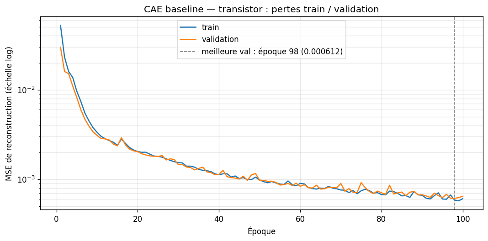
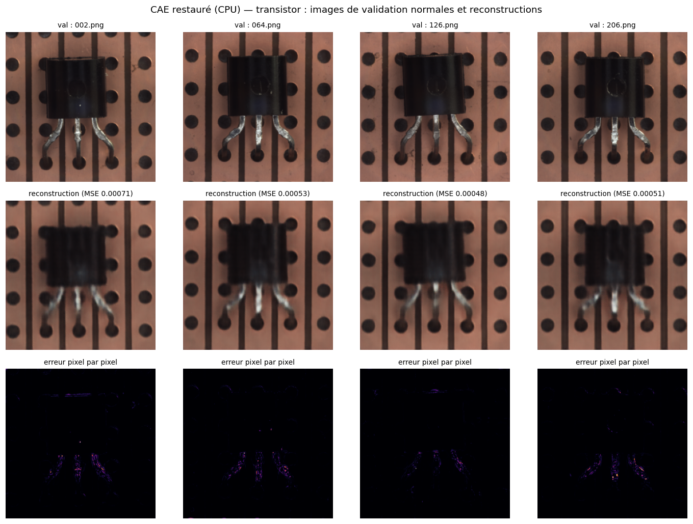

# US-03-03 — Entraîner et valider le CAE — Transistor

**Jira :** IDL-23 · sous-tâches **IDL-31** (ST-03-03-01, apprentissage) et **IDL-32** (ST-03-03-02, sauvegarde et restauration)  
**Expérience :** `cae-transistor/EXP-001` · **Branche :** `epic/03-convolutional-autoencoder`

**Résultat.** Le CAE de référence, entraîné 100 époques sur les 170 images normales de `transistor`, atteint une MSE de validation de **0,000612** à l'époque 98, sans surapprentissage. Ce checkpoint se recharge sur CPU sans réentraînement et retrouve la même perte (écart relatif 3,5 × 10⁻⁸).

## Critères d'acceptation et preuves

| # | Critère | Preuve | État |
|---|---|---|---|
| 1 | L'entraînement utilise uniquement les images normales du Train `transistor` | Manifeste US-02-03 : 170 images `train`, labels contrôlés à 0 ; le split `test` n'est jamais chargé (`test_used: false`) | ✅ |
| 2 | Pertes Train/Validation, hyperparamètres et version du code conservés | `history.csv`, `loss_curves.png`, `run_info.json` ; commit `6a353b3` ; fiche `cae-transistor/EXP-001` | ✅ |
| 3 | Meilleur checkpoint sélectionné sur validation et rechargé sans réentraînement | Sauvegarde à chaque amélioration de la val ; notebook `07` : perte val restaurée identique sur CPU | ✅ |
| 4 | Références des artefacts Kaggle documentées | § Artefacts ci-dessous et fiche `cae-transistor/EXP-001` | ✅ |

## Protocole

| Élément | Valeur |
|---|---|
| Modèle | `cae_baseline_v1` ([config](../../experiments/configs/cae_baseline.json), US-03-01) — 855 619 paramètres |
| Données | MVTec AD `ipythonx/mvtec-ad` (Version 2), [manifeste transistor](../data/us-02-03/transistor_manifest.csv) : 170 train, 43 val |
| Prétraitement | `MVTecTransform(size=(256, 256), profile="cae")` (US-02-04) |
| Entraînement | 100 époques, batch 16, Adam (lr 0,001), MSE, seed 42, sans early stopping |
| Sélection | Checkpoint de plus faible perte de validation sur toutes les époques |
| Environnement | Kaggle, Tesla T4 (x2), Python 3.13.16, PyTorch 2.11.0+cu130, torchvision 0.26.0+cu130 |
| Code | Modèle et pipeline : commit `6a353b3a3a3aa7a4adfa69a6db120d5bec95d73b` ; boucle d'entraînement : [`../../notebooks/06-cae-transistors-train.ipynb`](../../notebooks/06-cae-transistors-train.ipynb) |

Configuration de l'expérience : [`experiments/configs/cae_transistor.json`](../../experiments/configs/cae_transistor.json) (documentée après l'exécution, valeurs identiques à celles du notebook).

## Résultats de l'entraînement (Kaggle Version #1)

| Mesure | Valeur |
|---|---|
| Meilleure époque | 98 |
| Meilleure perte de validation | 0,000612 |
| Perte train / val à l'époque 100 | 0,000606 / 0,000646 |
| Durée | 12,0 min |

- **Pas de surapprentissage :** les pertes train et val restent proches à toutes les époques.
- **Convergence :** la perte val baisse encore légèrement vers les époques 90 à 100 ; plus d'époques pourraient l'améliorer un peu.
- **Fluctuations :** la val varie d'une époque à l'autre ; garder le meilleur checkpoint plutôt que le dernier évite ces creux.

## Restauration sans réentraînement

Le notebook [`07-cae-restore-check`](../../notebooks/07-cae-transistors-restore-check.ipynb) clone le dépôt au commit de l'entraînement, recrée le modèle depuis `cae_baseline.json`, charge `best_model.pt` sur **CPU** (`weights_only=True`, chargement strict) et recalcule la perte sur les 43 images de validation.

| Mesure | Valeur |
|---|---|
| Perte val enregistrée (GPU) | 0,0006124485 |
| Perte val restaurée (CPU) | 0,0006124485 |
| Écart relatif | 3,54 × 10⁻⁸ (tolérance 10⁻³) |

L'erreur de reconstruction des images normales est presque nulle, sauf de légers résidus sur les **pattes** (zones fines et brillantes). Les défauts `bent_lead` et `cut_lead`, situés à cet endroit et parmi les plus petits du dataset (US-02-02), risquent donc d'être plus difficiles à détecter : point à suivre en US-03-05.

## Artefacts

| Artefact | Emplacement |
|---|---|
| Checkpoint `best_model.pt` (3,4 Mo, non versionné dans Git) | Output Kaggle de `06-cae-train` : `cae/transistor/best_model.pt` |
| Version Kaggle — entraînement | https://www.kaggle.com/code/zakariaelbergui/06-cae-train?scriptVersionId=368211534 |
| Version Kaggle — restauration | https://www.kaggle.com/code/zakariaelbergui/07-cae-restore-check?scriptVersionId=368219576 |
| Fiche d'expérience | [`experiments/runs/cae-transistor/EXP-001.json`](../../experiments/runs/cae-transistor/EXP-001.json) |
| Preuves (copies des Outputs Kaggle) | [`docs/data/us-03-03/`](../data/us-03-03/) : `run_info.json`, `history.csv`, `loss_curves.png`, `restore_report.json`, `restored_reconstructions.png` |

## Réutilisation pour une autre catégorie

Le notebook `06-cae-train` est générique : changer `CATEGORY` (par exemple `"hazelnut"` pour US-03-04), exécuter, puis relancer `07-cae-restore-check` avec la même valeur de `CATEGORY`.

**Limite :** les métriques de détection (Image-AUROC, Pixel-AUROC, F1) ne sont pas calculées ici, car elles exigent le test officiel ; elles relèvent de US-03-05 et de l'EPIC-05.
