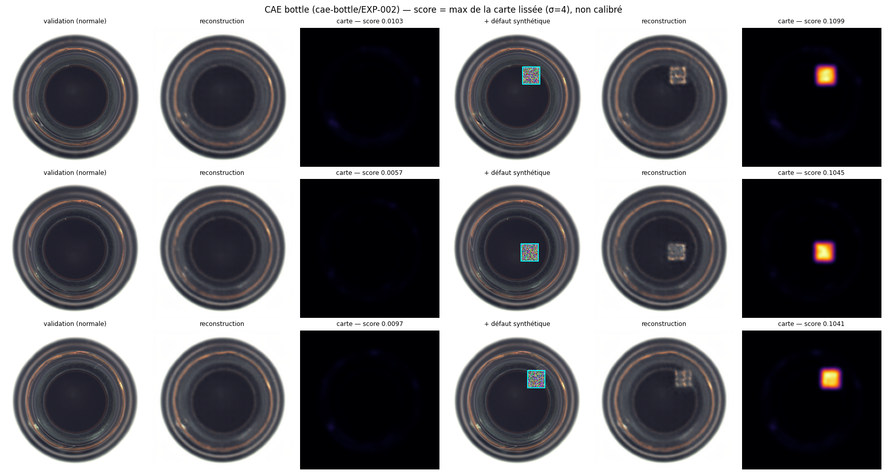
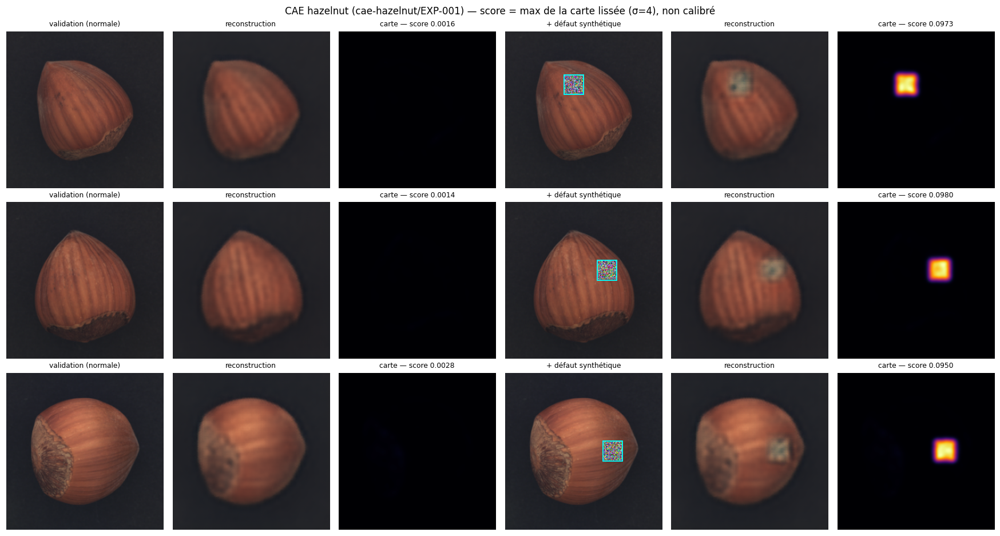
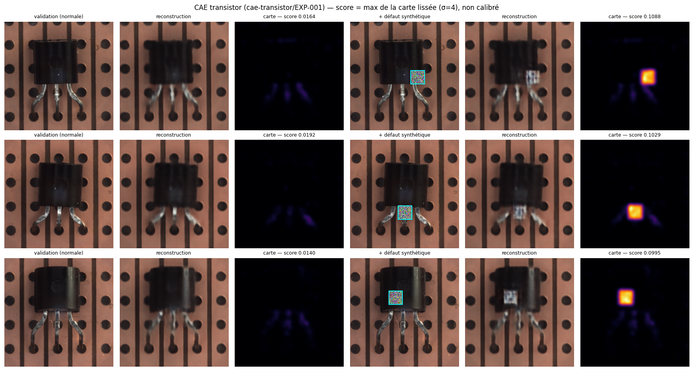

# US-03-05 — Inférence CAE, reconstructions et cartes d'anomalie

**Jira :** IDL-25 · sous-tâches **IDL-35** (ST-03-05-01, module d'inférence) et **IDL-36** (ST-03-05-02, tests sur les trois catégories)  
**Branche :** `feature/us-03-05-cae-inference` → `epic/03-convolutional-autoencoder`

**Résultat.** Le module [`src/inference/cae_inference.py`](../../src/inference/cae_inference.py) recharge le CAE d'une catégorie, reconstruit l'image et produit une carte d'anomalie et un score brut, sans calibration. Avec les trois vrais checkpoints, il retrouve exactement la MSE de validation de l'entraînement (écart relatif < 10⁻⁷) et localise 18 défauts synthétiques sur 18.

## Critères d'acceptation et preuves

| # | Critère | Preuve | État |
|---|---|---|---|
| 1 | Charger un checkpoint par catégorie et reconstruire l'image | `load_cae` / `CAEInference.from_checkpoint` ; notebook `10` : bottle, hazelnut et transistor chargés (SHA-256 identique aux fiches pour bottle et hazelnut) | ✅ |
| 2 | Calculer une carte de différence et un score image, sans calibration | `predict` / `predict_batch` : carte `[256, 256]` + score brut ; aucun seuil (US-05-02) | ✅ |
| 3 | Compatible avec le contrat d'inférence partagé | `CAEInferenceResult` : `category`, `model_family`, `model_name`, `score`, `anomaly_map` ; `to_dict()` sérialisable en JSON. Seuil, décision et latence seront ajoutés par US-06-01 | ✅ |
| 4 | Tests sur les dimensions et la cohérence pour les trois catégories | 16 tests unitaires ([`tests/inference/`](../../tests/inference/test_cae_inference.py)) + notebook `10` sur les vrais checkpoints | ✅ |

## Fonctionnement

```
image [3, 256, 256] dans [0, 1]  (MVTecTransform, profil "cae")
   │
   ▼  CAE
reconstruction [3, 256, 256]
   │
   ▼  (image − reconstruction)², moyenne sur les 3 canaux
carte brute [256, 256]
   │
   ▼  lissage gaussien σ = 4 (atténue le bruit isolé : contours, reflets)
carte d'anomalie [256, 256]  ──►  score = maximum de la carte (brut, non calibré)
```

| Réglage (`CAEInferenceConfig`) | Valeur par défaut | Rôle |
|---|---|---|
| `smoothing_sigma` | 4,0 | Lissage de la carte (0 = désactivé) |
| `score_method` | `"max"` | `"max"` : sensible aux petits défauts · `"mean"` : MSE moyenne, identique à la perte d'entraînement |

**Deux formats de checkpoint** coexistent dans le projet ; `extract_state_dict` accepte les deux :

| Catégorie | Format |
|---|---|
| bottle (Mouad), hazelnut (Marwane) | dictionnaire avec les poids sous `"model_state_dict"` + métadonnées |
| transistor (Zakaria) | poids seuls (`model.state_dict()`) |

## Tests unitaires (sans dataset ni GPU)

`python -m unittest discover -s tests/inference -p "test_*.py" -v` → **16 tests OK**

| Groupe | Ce qui est vérifié |
|---|---|
| Sorties | Images de 900 px (bottle) et 1024 px (hazelnut, transistor) → carte `[256, 256]`, reconstruction `[3, 256, 256]` dans `[0, 1]`, score fini ≥ 0 ; `to_dict()` sérialisable ; lot = images une par une |
| Rechargement | Sauvegarde puis rechargement → résultats identiques ; format `model_state_dict` accepté ; fichier absent, autre architecture ou format inconnu refusés |
| Carte et score | Reconstruction parfaite → carte et score nuls ; calcul exact de `max` et `mean` ; le pic de la carte tombe dans la zone effacée ; le lissage atténue un pixel isolé bien plus qu'une région |
| Entrées invalides | Mauvais nombre de dimensions, valeurs hors `[0, 1]`, mauvaise taille, configuration invalide → `ValueError` |

## Vérification sur les vrais checkpoints (Kaggle)

Notebook [`10-cae-inference-check`](../../notebooks/10-cae-inference-check.ipynb) — commit `f12105d`, GPU T4.

> **Protocole :** le split `test` est réservé à l'évaluation finale (`split_protocol.json`). Seule la **validation** (images normales) est utilisée ; les défauts sont **synthétiques** (carré de bruit uniforme de 32 × 32 px, seed 42).

### Chargement et cohérence avec l'entraînement

| Catégorie | Expérience | Format | SHA-256 = fiche | Val MSE de la fiche | Val MSE recalculée | Écart relatif |
|---|---|---|---|---|---|---|
| bottle | `cae-bottle/EXP-002` | dict | ✅ | 0,0003680491 | 0,0003680491 | 7,7 × 10⁻⁸ |
| hazelnut | `cae-hazelnut/EXP-001` | dict | ✅ | 0,0002059518 | 0,0002059518 | 4,7 × 10⁻⁸ |
| transistor | `cae-transistor/EXP-001` | poids seuls | — (non enregistré) | 0,0006124485 | 0,0006124485 | 3,6 × 10⁻⁸ |

Les 163 images de validation passent toutes les vérifications de forme et de valeurs. Le moteur d'inférence redonne la perte de l'entraînement : le bon modèle est chargé avec le bon prétraitement.

### Défauts synthétiques

| Catégorie | Score en hausse | Pic de la carte sur le défaut | Ratio médian des scores (défaut / normal) |
|---|---|---|---|
| bottle | 6/6 | 6/6 | × 10,7 |
| hazelnut | 6/6 | 6/6 | × 44,3 |
| transistor | 6/6 | 6/6 | × 6,8 |





**Lecture :**
- La carte reste sombre sur les images normales et s'allume précisément sur le carré ajouté.
- **Transistor** a l'écart le plus faible (× 6,8) : sa texture (pattes, fond perforé) est moins bien reconstruite, ce qui élève le score des images normales. C'est cohérent avec sa val MSE, la plus haute des trois, et avec les résidus sur les pattes notés en US-03-03 : c'est probablement la catégorie la plus difficile pour le CAE.

## Artefacts

| Artefact | Emplacement |
|---|---|
| Module d'inférence | [`src/inference/cae_inference.py`](../../src/inference/cae_inference.py) |
| Tests | [`tests/inference/test_cae_inference.py`](../../tests/inference/test_cae_inference.py) |
| Version Kaggle — vérification | https://www.kaggle.com/code/zakariaelbergui/10-cae-inference-check?scriptVersionId=368593541 |
| Preuves (copies de l'Output Kaggle) | [`docs/data/us-03-05/`](../data/us-03-05/) : `inference_report.json`, `bottle_inference.png`, `hazelnut_inference.png`, `transistor_inference.png` |
| Checkpoints (non versionnés dans Git) | bottle : Output `mouadfekkak/06-cae-bottle-training` v368423258 · hazelnut : Output `marwanedrissi/industrialdefect-ai-cae-hazelnut-training` · transistor : Output `zakariaelbergui/06-cae-train` v368211534 |

## Limites et suite

- **Pas de métrique de détection** (Image-AUROC, Pixel-AUROC, F1) : elles exigent le split test et relèvent de l'EPIC-05. Les défauts synthétiques valident le fonctionnement de la carte, pas la performance sur de vrais défauts.
- **Score non calibré** : le seuil normal / défaut sera fixé sur la validation en US-05-02.
- **Budgets d'entraînement différents** : bottle 500 époques, hazelnut 150, transistor 100. À garder en tête pour comparer les catégories.
- Pour le contrat partagé (US-06-01), il restera à ajouter la version du modèle, le seuil, la décision et la latence.
