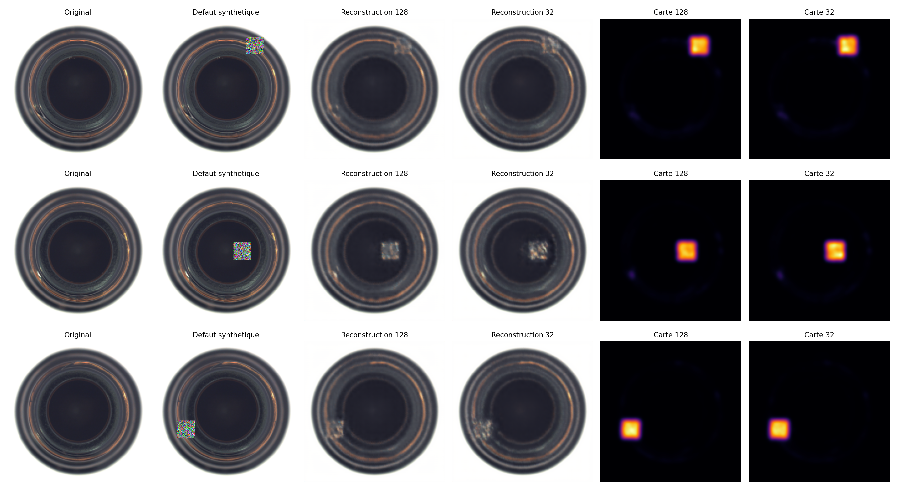
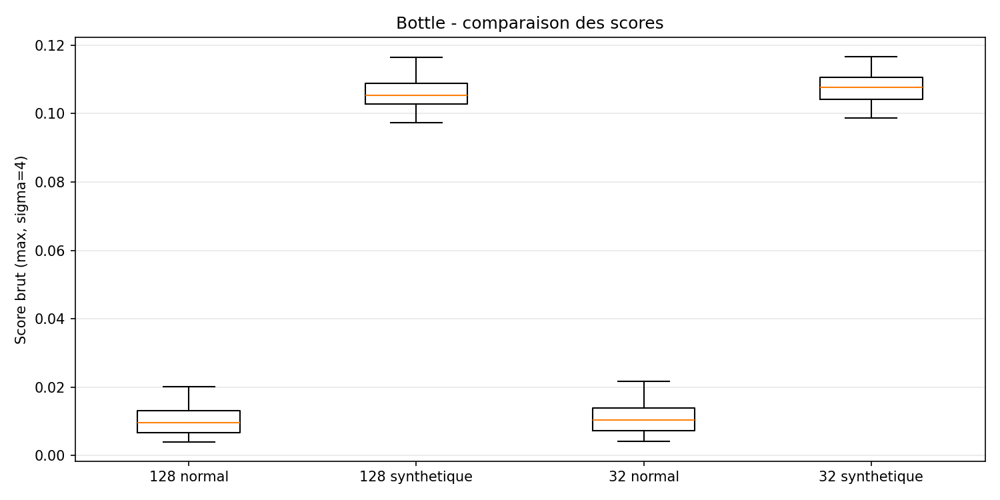

# US-03-06 — Étude de l'influence de la taille du bottleneck

**Epic :** EPIC-03 — Convolutional Autoencoder

**Branche d'intégration :** `epic/03-convolutional-autoencoder` 
**Catégorie :** MVTec AD — Bottle

## 1. Objectif

Étudier expérimentalement l'influence de la capacité du bottleneck d'un Convolutional Autoencoder (CAE) sur :

- La qualité de reconstruction des images normales.
- Les scores et les cartes d'anomalie.
- Le coût de calcul, la taille du modèle et la latence d'inférence.

Deux variantes du même CAE sont comparées :

- **EXP-002 :** modèle de référence avec 128 canaux latents.
- **EXP-003 :** modèle expérimental avec 32 canaux latents.

L'étude est organisée en deux subtasks :

- **ST-03-06-01 :** expérimenter deux tailles de bottleneck à protocole constant.
- **ST-03-06-02 :** comparer reconstruction, anomalies et coût, puis rédiger la conclusion.

## 2. Protocole expérimental

### 2.1. Données et entraînement

Les deux modèles utilisent les mêmes données, le même prétraitement et les mêmes hyperparamètres d'entraînement.

| Paramètre | Valeur |
|---|---|
| Dataset | MVTec AD — Bottle, version 2 |
| Source Kaggle | `ipythonx/mvtec-ad` |
| Train | 167 images normales |
| Validation | 42 images normales |
| Résolution | 256 × 256 RGB |
| Encodeur | (32, 64, 128) |
| Optimiseur | Adam |
| Fonction de perte | MSELoss |
| Learning rate | 0.001 |
| Batch size | 16 |
| Seed | 42 |
| Maximum epochs | 500 |
| Early Stopping patience | 40 |
| Early Stopping min_delta | 1e-6 |

La seule modification architecturale concerne `latent_channels`, qui passe de 128 à 32.

La représentation latente conserve ses dimensions spatiales de 16 × 16 :

- EXP-002 : 128 × 16 × 16 = 32 768 valeurs.
- EXP-003 : 32 × 16 × 16 = 8 192 valeurs.

La capacité de la représentation latente est ainsi divisée par quatre.

Le découpage Train/Validation est identique pour les deux expériences et respecte le manifeste `docs/data/us-02-03/bottle_manifest.csv`.

Le test officiel MVTec AD n'a été utilisé ni pour l'entraînement ni pour la sélection des checkpoints.

### 2.2. Protocole de comparaison

La comparaison réutilise le module `src/inference/cae_inference.py`, développé dans l'US-03-05.

Les deux checkpoints sont restaurés sans réentraînement.

Les expériences utilisent :

| Paramètre | Valeur |
|---|---|
| Images normales | 42 images de validation |
| Images synthétiques | 42 images modifiées |
| Défaut synthétique | Carré de bruit uniforme 32 × 32 pixels |
| Seed | 42 |
| Méthode de score | `max` |
| Lissage gaussien | `sigma = 4.0` |
| GPU | Tesla T4 |
| Latence | 10 warmups + 50 répétitions par modèle |
| Seuil de classification | Aucun |

Les défauts synthétiques sont appliqués aux mêmes images, avec les mêmes positions et les mêmes valeurs, pour les deux modèles.

Le score d'anomalie est calculé à partir de l'erreur quadratique de reconstruction, moyennée sur les canaux RGB, puis lissée spatialement. Le score image correspond au maximum de cette carte lissée.

Les scores restent bruts et non calibrés.

L'AUROC calculée sur les anomalies synthétiques est une mesure exploratoire. Elle ne représente pas l'Image-AUROC officielle sur les véritables défauts MVTec AD.

## 3. Résultats — ST-03-06-01

### 3.1. Résultats des entraînements

| Indicateur | EXP-002 (128) | EXP-003 (32) |
|---|---:|---:|
| Paramètres entraînables | 855 619 | 462 307 |
| Epochs exécutées | 500 | 500 |
| Meilleure epoch | 495 | 492 |
| Train MSE à la meilleure epoch | 0.00037027 | 0.00035996 |
| Meilleure Validation MSE | 0.00036805 | 0.00038182 |
| Temps d'entraînement | 69 min 54 s | 70 min 18 s |
| Motif d'arrêt | Max epochs | Max epochs |

Les deux entraînements ont atteint leur limite de 500 epochs.

Le meilleur checkpoint a été sélectionné sur la plus faible Validation MSE, et non sur la dernière epoch.

### 3.2. Analyse

**Réduction de la capacité**

La variante à 32 canaux possède environ 46 % de paramètres entraînables en moins que celle à 128 canaux.

Cette réduction est obtenue sans modifier les dimensions des images, les trois couches initiales de l'encodeur ou le protocole d'entraînement.

**Qualité de reconstruction**

La Validation MSE passe de 0.00036805 à 0.00038182, soit une augmentation d'environ 3,74 %.

Le modèle à 128 canaux présente donc une reconstruction légèrement meilleure des images normales.

Cependant, l'écart reste relativement faible malgré la réduction importante du nombre de paramètres.

**Coût d'entraînement**

Les deux entraînements durent environ 70 minutes.

La réduction du bottleneck n'a donc pas produit de gain de temps notable dans ces exécutions.

Cela peut notamment s'expliquer par le fait que les autres couches du réseau, le traitement des images et les opérations effectuées sur le GPU restent largement identiques.

Cette première comparaison ne suffit pas à déterminer quelle variante détecte le mieux les anomalies industrielles.

## 4. Résultats — ST-03-06-02

### 4.1. Validation de la restauration

Les deux checkpoints ont été rechargés avec le module d'inférence de l'US-03-05.

Les SHA-256 des checkpoints ont été vérifiés avant leur utilisation.

| Vérification | EXP-002 | EXP-003 |
|---|---|---|
| Checkpoint chargé | OK | OK |
| Architecture attendue | 128 canaux | 32 canaux |
| SHA-256 | Conforme | Conforme |
| Validation MSE reproduite | 0.00036805 | 0.00038182 |
| Réentraînement nécessaire | Non | Non |

Les MSE recalculées correspondent aux valeurs enregistrées lors des entraînements, à la tolérance numérique près.

Cela confirme la cohérence du chargement, des poids et du prétraitement.

### 4.2. Comparaison des scores d'anomalie

Les scores sont calculés sur 42 images normales et sur leurs 42 versions comportant un défaut synthétique.

| Indicateur | EXP-002 (128) | EXP-003 (32) |
|---|---:|---:|
| Score moyen normal | 0.010554 | 0.011118 |
| Score moyen synthétique | 0.105581 | 0.108089 |
| Ratio médian synthétique / normal | 10.7914 | 10.7915 |
| Augmentation du score après ajout du défaut | 100 % | 100 % |
| Synthetic AUROC exploratoire | 1.0000 | 1.0000 |

**Analyse**

Les deux modèles produisent des scores nettement plus élevés sur les images contenant un défaut synthétique que sur les images normales correspondantes.

Pour les deux variantes, le score augmente sur les 42 images modifiées.

Les distributions des scores normaux et synthétiques sont entièrement séparées dans cette expérience, ce qui explique l'AUROC exploratoire de 1.0000.

Les ratios médians sont pratiquement identiques, autour de 10,79.

Ces résultats indiquent qu'avec ce type précis de défaut artificiel, réduire la capacité du bottleneck de 128 à 32 canaux ne dégrade pas la discrimination observée.

Toutefois, les défauts synthétiques utilisés sont relativement visibles et ne représentent pas nécessairement la difficulté des véritables défauts industriels, notamment les défauts subtils ou de faible surface.

Il n'est donc pas possible de conclure que les deux modèles possèdent des performances équivalentes sur le test officiel.

### 4.3. Comparaison des reconstructions et cartes d'anomalie

Les reconstructions et cartes d'anomalie ont été générées avec les mêmes images et les mêmes paramètres d'inférence.

La figure présente, pour trois exemples :

- L'image normale originale.
- L'image comportant un défaut synthétique.
- La reconstruction avec 128 canaux.
- La reconstruction avec 32 canaux.
- La carte d'anomalie du modèle à 128 canaux.
- La carte d'anomalie du modèle à 32 canaux.

Pour chaque image, les deux cartes d'anomalie partagent la même échelle de couleurs afin de permettre une comparaison visuelle cohérente.

La distribution des scores des deux modèles est également disponible :

Les scores synthétiques sont nettement supérieurs aux scores des images normales pour les deux architectures.

Cette comparaison qualitative et quantitative porte sur les défauts synthétiques. Aucune mesure de localisation sur les véritables masques d'anomalie du test officiel n'est réalisée dans cette User Story.

### 4.4. Comparaison du coût mémoire et de la latence

| Indicateur | EXP-002 (128) | EXP-003 (32) |
|---|---:|---:|
| Paramètres entraînables | 855 619 | 462 307 |
| Checkpoint | 3.429 MB | 1.856 MB |
| Latence médiane | 8.358 ms | 8.328 ms |
| Latence moyenne | 8.369 ms | 8.366 ms |
| Écart-type latence | 0.070 ms | 0.141 ms |
| Répétitions | 50 | 50 |

**Analyse**

La réduction de 128 à 32 canaux entraîne :

- Une diminution d'environ 46 % du nombre de paramètres.
- Une diminution d'environ 46 % de la taille du checkpoint.
- Une différence de latence médiane d'environ 0,030 ms, soit 0,36 %.

Le modèle à 32 canaux occupe donc moins d'espace de stockage.

En revanche, le gain de latence mesuré est négligeable au regard des variations observées.

La latence comprend l'inférence sur un tenseur déjà prétraité, le calcul des cartes et des scores, ainsi que le retour des résultats vers le CPU. Elle ne comprend pas la lecture ni le prétraitement de l'image source.

Ces mesures ne démontrent donc pas que le modèle à 32 canaux est significativement plus rapide.

## 5. Reproductibilité et artefacts

### 5.1. EXP-002 — Bottleneck 128

- Architecture : `experiments/configs/cae_baseline.json`
- Configuration : `experiments/configs/cae_bottle_exp002.json`
- Métadonnées : `experiments/runs/cae-bottle/EXP-002.json`
- Tag Git : `exp/cae-bottle-exp002`
- Commit d'entraînement : `52d4bbd839191e74d296892411062bc701da4aba`
- [Résultats Kaggle EXP-002](https://www.kaggle.com/code/mouadfekkak/06-cae-bottle-training/output?scriptVersionId=368423258)

### 5.2. EXP-003 — Bottleneck 32

- Architecture : `experiments/configs/cae_bottle_bottleneck32.json`
- Configuration : `experiments/configs/cae_bottle_bottleneck32_exp003.json`
- Notebook : `notebooks/08-cae-bottle-bottleneck-study.ipynb`
- Métadonnées : `experiments/runs/cae-bottle/EXP-003.json`
- Tag Git : `exp/cae-bottle-bottleneck32-exp003`
- Commit d'entraînement : `31f0a49d51615abe158e73c391f695dba9041a1b`
- [Résultats Kaggle EXP-003](https://www.kaggle.com/code/mouadfekkak/08-cae-bottle-bottleneck-study?scriptVersionId=368562382)

### 5.3. Étude comparative — ST-03-06-02

- Identifiant : `US-03-06-CMP-001`
- Notebook : `notebooks/11-cae-bottle-bottleneck-comparison.ipynb`
- Module d'inférence : `src/inference/cae_inference.py`
- Tag Git : `exp/cae-bottle-comparison-st030602-v1`
- Commit exécuté : `876be5bde391816e024977894bf7ec1ebbc142e5`
- [Résultats Kaggle de la comparaison](https://www.kaggle.com/code/mouadfekkak/11-cae-bottle-bottleneck-comparison/notebook?scriptVersionId=368797276)

Artefacts générés :

| Fichier | Contenu |
|---|---|
| `docs/data/us-03-06/comparison_report.json` | Protocole, provenance, scores, latences et métriques |
| `docs/data/us-03-06/comparison_examples.png` | Comparaison visuelle des reconstructions et cartes d'anomalie |
| `docs/data/us-03-06/comparison_scores.png` | Distributions des scores normaux et synthétiques |

L'environnement de comparaison utilise Python 3.13.16, PyTorch 2.11.0+cu130 et un GPU Tesla T4.

Le rapport JSON conserve les identifiants des commits, les références Kaggle, les SHA-256 des checkpoints, les paramètres de comparaison et les résultats détaillés.

Les checkpoints volumineux restent stockés sur Kaggle et ne sont pas versionnés dans GitHub.

## 6. Conclusion scientifique

L'étude met en évidence un compromis entre la capacité du bottleneck, la qualité de reconstruction et le coût du modèle.

**1. Reconstruction**

Le CAE à 128 canaux présente une Validation MSE environ 3,74 % plus faible. Il conserve donc un léger avantage pour reconstruire les images normales.

**2. Détection des anomalies synthétiques**

Les deux modèles obtiennent une AUROC exploratoire de 1.0000 sur les défauts synthétiques utilisés.

La réduction de la capacité latente ne provoque donc aucune dégradation de la séparation entre images normales et images synthétiquement modifiées dans ce protocole.

**3. Coût mémoire**

Le CAE à 32 canaux réduit d'environ 46 % le nombre de paramètres et la taille du checkpoint.

Il représente ainsi une solution plus compacte.

**4. Coût d'inférence**

Les latences mesurées sont pratiquement identiques. Aucun avantage significatif de rapidité n'est établi.

### Compromis observé

Pour cette expérience sur Bottle, le bottleneck à 32 canaux constitue un compromis intéressant : il réduit fortement la taille du modèle tout en conservant une qualité de reconstruction proche de la référence et des résultats équivalents sur les anomalies synthétiques étudiées.

Le bottleneck à 128 canaux reste cependant légèrement meilleur en reconstruction normale.

**Aucune variante ne peut être déclarée supérieure pour la détection des véritables défauts industriels à ce stade.**

### Limites

Cette étude présente plusieurs limites :

- Une seule catégorie industrielle (`bottle`) a été étudiée.
- Seules deux capacités latentes ont été comparées.
- Les défauts utilisés pour la comparaison des scores sont synthétiques.
- Aucune métrique de détection ou de localisation sur les véritables anomalies du test officiel n'a été calculée.
- La latence a été mesurée dans un seul environnement GPU, avec 50 répétitions par modèle.
- Les différences de latence observées sont trop faibles pour établir un avantage significatif.

Une évaluation sur le test officiel MVTec AD sera nécessaire pour mesurer les performances réelles de détection et de localisation, avec un protocole figé avant consultation des résultats.

Le test ne devra pas servir à optimiser les hyperparamètres ou les seuils.

---

**État de l'US-03-06 :**

- **ST-03-06-01 :** entraînement, validation et comparaison des deux capacités — réalisé.
- **ST-03-06-02 :** comparaison des reconstructions, scores synthétiques, latences et coût ; analyse et conclusion — réalisé.

**Livrables :** configurations, notebooks reproductibles, checkpoints Kaggle référencés, métadonnées JSON, figures comparatives et documentation scientifique.