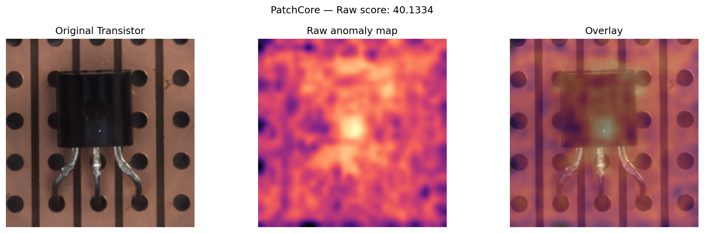

# US-04-03 — Construire la Memory Bank PatchCore — Transistor

**Jira :** IDL-41 · sous-tâches **IDL-48** (ST-04-03-01, construction) et **IDL-49** (ST-04-03-02, sauvegarde, restauration et scoring)  
**Expérience :** `patchcore-transistor/EXP-001` · **Branche :** `feature/us-04-03-patchcore-transistor` → `epic/04-patchcore`

**Résultat.** La Memory Bank Transistor est construite à partir des 170 normales Train uniquement : 174 080 vecteurs de patches réduits à **1 740** par KCenterGreedy (1 %). Le checkpoint se restaure dans une session Kaggle CPU indépendante et retrouve le score GPU à 1,1 × 10⁻⁵ près.

- [Configuration](../../experiments/configs/patchcore_transistor.json) · [Fiche d'expérience](../../experiments/runs/patchcore-transistor/EXP-001.json)
- [Notebook GPU](../../notebooks/14-patchcore-transistor-memory-bank.ipynb) · [Notebook CPU](../../notebooks/15-patchcore-transistor-restore-check.ipynb)
- [Tests des preuves](../../tests/experiments/test_patchcore_transistor_exp001.py)

## Critères d'acceptation et preuves

| # | Critère | Preuve | État |
|---|---|---|---|
| 1 | Extraction uniquement depuis les normales Train Transistor | Les 170 chemins traités (`memory_bank_report.json`) sont exactement le Train du manifeste, uniques et disjoints de Validation et Test ; vérifié par un test automatique | ✅ |
| 2 | Paramètres du backbone, couches et coreset documentés | Configuration, fiche d'expérience et tableau ci-dessous | ✅ |
| 3 | Memory Bank sauvegardée, restaurée et testée | Restauration dans la session GPU, puis restauration CPU indépendante : PASS dans les trois tolérances | ✅ |

## Protocole

Le protocole reproduit celui de [US-04-02 (Bottle)](us-04-02.md) : le notebook `14` est le notebook Bottle, dont seules les valeurs propres à la catégorie changent. Les deux catégories sont donc comparables.

| Élément | Valeur |
|---|---|
| Données | MVTec AD `ipythonx/mvtec-ad` v2, [manifeste Transistor](../data/us-02-03/transistor_manifest.csv) : 170 Train, 43 Validation, 100 Test (non utilisé) |
| Prétraitement | `MVTecTransform(size=(256, 256), profile="patchcore")` : RGB, resize 256 × 256, normalisation ImageNet |
| Backbone | `wide_resnet50_2` pré-entraîné ImageNet, **gelé** : 24 862 528 paramètres, 0 entraînable |
| Couches | `layer2` [B, 512, 32, 32] et `layer3` [B, 1024, 16, 16], concaténées en 1 536 dimensions sur une grille 32 × 32 |
| Extraction | `forward()` officiel d'Anomalib 2.7.0 en mode collecte : pooling local, alignement des couches et concaténation identiques à l'inférence |
| Coreset | KCenterGreedy, ratio 0,01, seed 42 |
| Inférence | 1 plus proche voisin ; image `transistor/train/good/002.png`, du split logique Validation |
| Batch / workers | 2 / 0 ; aucune optimisation par époques |
| Code | Commit `76589696aabc801f346a0759f5d4cd04efcd0d70`, tag `exp/patchcore-transistor-exp001` |

## Construction de la Memory Bank (Kaggle GPU)

Version [369642459](https://www.kaggle.com/code/zakariaelbergui/14-patchcore-transistor-memory-bank?scriptVersionId=369642459) · Tesla T4 · Python 3.13 · Torch 2.11.0+cu130 · Anomalib 2.7.0 · timm 1.0.30 · Lightning 2.6.6

| Mesure | Transistor (EXP-001) | Bottle (US-04-02, pour comparaison) |
|---|---:|---:|
| Images Train | 170 | 167 |
| Vecteurs extraits | 174 080 × 1 536 | 171 008 × 1 536 |
| Memory Bank | **1 740 × 1 536** | 1 710 × 1 536 |
| Score brut sur une normale de Validation | **40,1334** | 29,3663 |
| Carte d'anomalie | [1, 1, 256, 256], valeurs de 17,3 à 39,5 | [1, 1, 256, 256] |

- Le score est une **distance brute**, pas une probabilité. Il est plus élevé que pour Bottle sur une image normale : la texture de Transistor (pattes, fond perforé) est plus variée, comme déjà observé avec le CAE (US-03-05).
- La carte n'est pas uniforme sur une image normale : sans seuil, PatchCore fait toujours ressortir les zones les moins fréquentes, ici le boîtier. Le seuil sera calibré en US-05-02.

**Reproductibilité GPU.** Une exécution interactive antérieure a donné un score de 40,2355 (écart de 0,25 %). Les calculs GPU de l'extraction ne sont pas bit à bit déterministes, et un écart infime peut changer un choix de KCenterGreedy, donc la banque. La version 369642459 est la référence : son checkpoint (SHA-256 `7917810678f656324236a0df6db639d7de93176a7a8ae9ef06e72f3bf0a57191`) est celui qui est restauré ci-dessous. Des versions Kaggle antérieures ont été annulées sans exécution (file d'attente GPU).

## Restauration CPU indépendante

Version [369649621](https://www.kaggle.com/code/zakariaelbergui/15-patchcore-transistor-restore-check?scriptVersionId=369649621) · sans accélérateur · Python 3.13.18 · Torch 2.11.0+cpu

Le notebook `15` vérifie le SHA-256 du checkpoint, le commit et le tag, les empreintes de la configuration et du manifeste, puis reconstruit le modèle avec `pre_trained=False` et charge le `state_dict` en mode strict. La banque de 1 740 vecteurs est restaurée **sans nouvelle extraction ni nouveau coreset**, puis la même image est scorée sur CPU.

| Mesure | Observé | Tolérance |
|---|---:|---:|
| Score GPU de référence | 40,13337707519531 | — |
| Score CPU restauré | 40,13338851928711 | — |
| Écart absolu du score | 1,14 × 10⁻⁵ | 0,001 |
| Écart absolu maximal de la carte | 1,51 × 10⁻⁴ | 0,001 |
| Écart maximal rapporté à l'étendue de la carte | 6,79 × 10⁻⁶ | 0,0001 |

**Compatibilité US-04-05.** Le checkpoint suit le schéma attendu par `load_patchcore` (`model_state_dict`, `backbone`, `layers`, `num_neighbors` à la racine) : il est directement utilisable par l'API d'inférence PatchCore.

## Artefacts

| Artefact | Emplacement |
|---|---|
| Checkpoint `patchcore_model.pt` (110 Mo, hors Git) | Output Kaggle de la version 369642459 : `patchcore/transistor/EXP-001/patchcore_model.pt` |
| Preuves (copies des Outputs Kaggle) | [`docs/data/us-04-03/`](../data/us-04-03/) : `memory_bank_report.json`, `reference_prediction.npz`, `anomaly_visualization.png`, `restore_report.json` |
| Contrôles automatiques | `python -m unittest discover -s tests/experiments -p "test_*.py"` : 6 tests sur les preuves Transistor (chemins Train, formes, concordance des rapports, NPZ, tolérances) |

## Limites

- Une seule image de Validation est scorée : c'est un contrôle de fonctionnement, pas une mesure de performance.
- Pas de seuil (US-05-02) ni de métriques Image-AUROC, Pixel-AUROC ou F1, qui exigent le split Test (EPIC-05).
- La reconstruction bit à bit du coreset sur un autre GPU n'est pas démontrée ; seule la restauration du checkpoint de référence l'est.
