# US-05-04 — Galerie comparative des erreurs

Treize images choisies par la règle publiée dans la [fiche scientifique](us-05-04.md), avant
inspection des cartes/RGB. Chaque planche compare les deux modèles sur la même image et le même
masque. **FP/FN est un verdict image**, jamais un verdict pixel. Les échelles min–max sont propres
à chaque carte, avec leurs valeurs brutes : une couleur vive ne permet pas de comparer la gravité
des anomalies entre images ou modèles. Les normales ont un masque vide, sans contour ajouté.

Les [sélections et références NPZ](../data/us-05-04/selection.json),
[empreintes des images sources](../data/us-05-04/source-images.json) et
[diagnostics spatiaux](../data/us-05-04/spatial-diagnostics.json) permettent de vérifier chaque figure.
Cartes et masques archivés sont sur la grille 256 × 256. RGB bilinéaire, GT nearest, aucun recadrage.
Sources : MVTec AD (Bergmann et al., MVTec Software GmbH), Kaggle ipythonx v2 ;
figures dérivées CC BY-NC-SA 4.0. Toute interprétation causale est présentée comme une hypothèse.

## case-01 — `bottle/test/broken_large/002.png`

Strate : **cae-bottle / FN / broken_large**, rang 4/7 en distance au seuil.

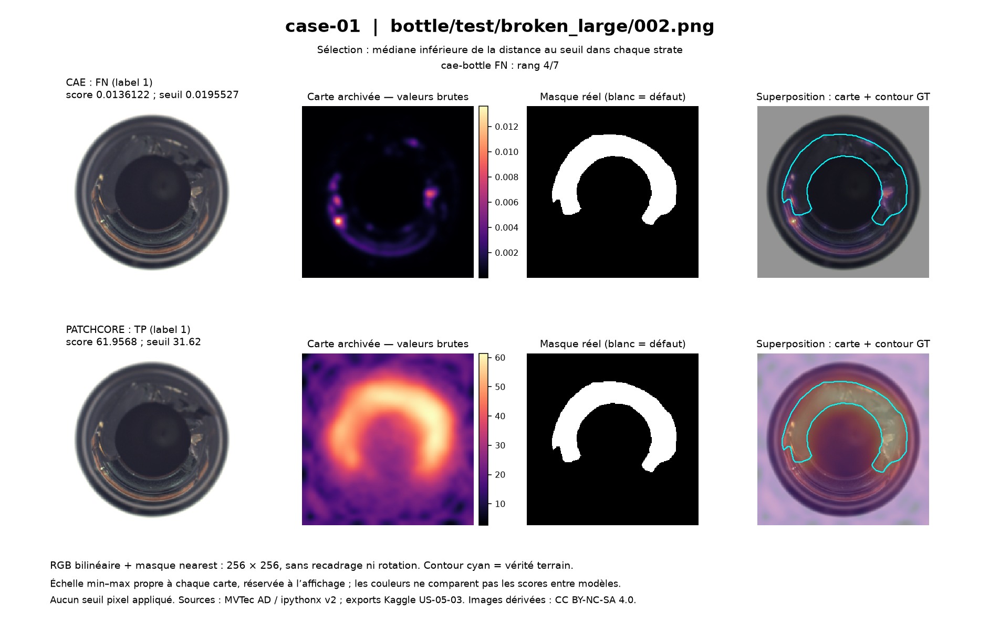

| Modèle | Verdict image | Score | Seuil figé | Marge signée | Maximum dans GT |
|---|---|---:|---:|---:|---|
| cae | FN | 0.013612207 | 0.0195526975 | -0.0059404905 | Non |
| patchcore | TP | 61.9568214 | 31.6200441 | 30.3367773 | Oui |

Le CAE répond surtout par points sur le pourtour, avec un maximum hors du masque ; PatchCore présente une zone en arc qui recouvre une grande partie de la cassure annotée. Le CAE reste FN malgré une zone annotée étendue (15,54 % des pixels). La surface seule n'explique donc pas son échec.

## case-02 — `bottle/test/broken_small/015.png`

Strate : **cae-bottle / FN / broken_small**, rang 2/4 en distance au seuil.

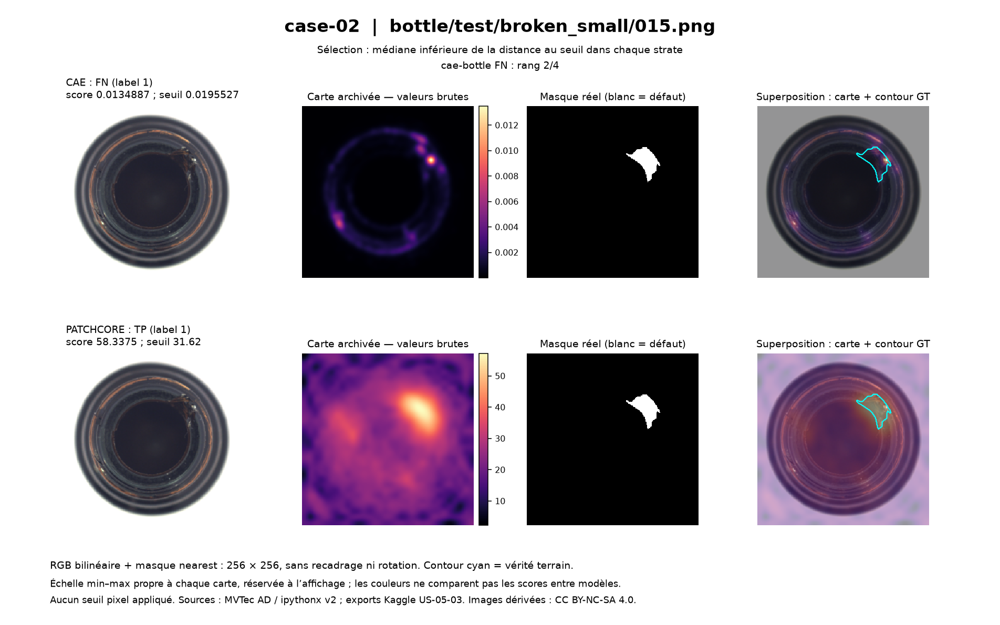

| Modèle | Verdict image | Score | Seuil figé | Marge signée | Maximum dans GT |
|---|---|---:|---:|---:|---|
| cae | FN | 0.0134886643 | 0.0195526975 | -0.00606403323 | Oui |
| patchcore | TP | 58.3375092 | 31.6200441 | 26.717465 | Oui |

Les deux cartes répondent près de la petite cassure, et leurs maxima sont dans le masque. Le CAE reste pourtant sous son seuil image. C'est un contre-exemple explicite à l'assimilation d'un FN image à une absence de réponse spatiale.

## case-03 — `bottle/test/contamination/016.png`

Strate : **cae-bottle / FN / contamination**, rang 8/15 en distance au seuil.

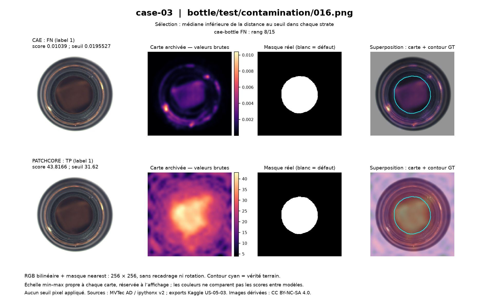

| Modèle | Verdict image | Score | Seuil figé | Marge signée | Maximum dans GT |
|---|---|---:|---:|---:|---|
| cae | FN | 0.0103899725 | 0.0195526975 | -0.00916272504 | Non |
| patchcore | TP | 43.8165627 | 31.6200441 | 12.1965185 | Oui |

La contamination centrale est visible dans le RGB. Le CAE montre une réponse centrale mais son maximum se situe sur le bord, hors du masque ; PatchCore concentre davantage sa réponse sur la zone contaminée et classe l'image TP. Les reflets/contours normaux sont une explication possible de la réponse périphérique, pas une cause démontrée par cette observation seule.

## case-04 — `bottle/test/good/001.png`

Strate : **patchcore-bottle / FP / good**, rang 1/1 en distance au seuil.

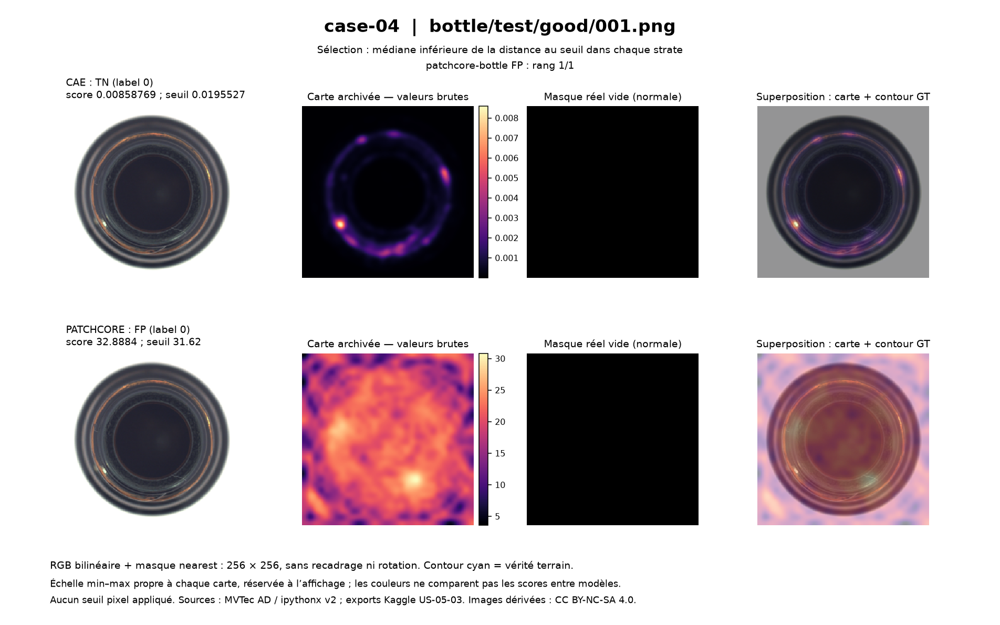

| Modèle | Verdict image | Score | Seuil figé | Marge signée | Maximum dans GT |
|---|---|---:|---:|---:|---|
| cae | TN | 0.00858769286 | 0.0195526975 | -0.0109650047 | Non applicable (normale) |
| patchcore | FP | 32.8883934 | 31.6200441 | 1.26834927 | Non applicable (normale) |

Image normale : le masque reste vide, sans contour de défaut inventé. PatchCore produit l'unique FP Bottle ; CAE est TN. La carte PatchCore varie sur le corps de la bouteille et le fond, mais ses couleurs vives résultent aussi de son échelle d'affichage propre. Son score natif dépasse le seuil image, même si le maximum de sa carte redimensionnée est inférieur à ce seuil.

## case-05 — `hazelnut/test/crack/002.png`

Strate : **cae-hazelnut / FN / crack**, rang 3/6 en distance au seuil.

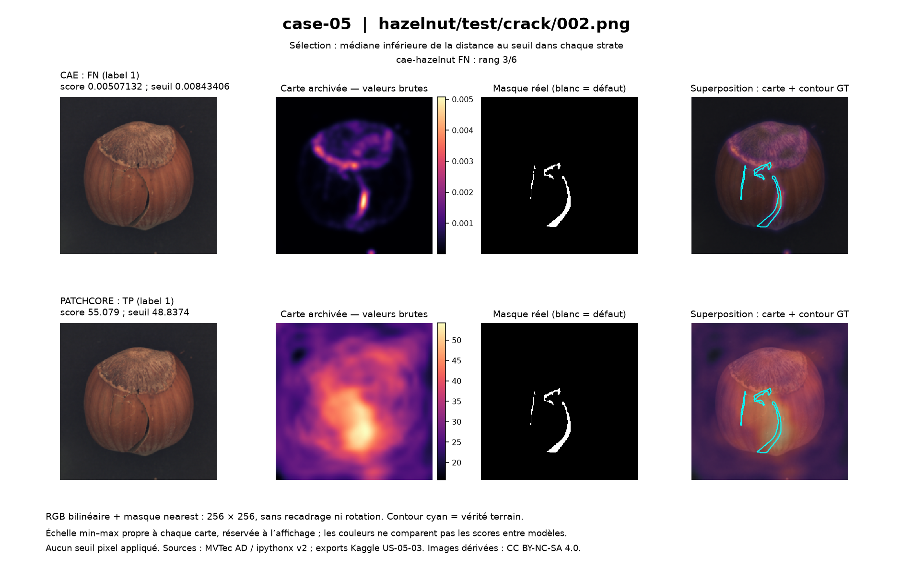

| Modèle | Verdict image | Score | Seuil figé | Marge signée | Maximum dans GT |
|---|---|---:|---:|---:|---|
| cae | FN | 0.00507132011 | 0.00843406352 | -0.00336274342 | Oui |
| patchcore | TP | 55.0789566 | 48.837368 | 6.24158859 | Non |

Le CAE fait ressortir une partie de la fissure et son maximum est dans le masque, mais son score image reste sous le seuil. PatchCore détecte l'image ; sa réponse est plus diffuse et son maximum tombe juste hors de la fine annotation. Ce TP ne prouve pas un contour de segmentation exact, et cet argmax hors masque ne constitue pas à lui seul une erreur de segmentation binaire.

## case-06 — `hazelnut/test/cut/001.png`

Strate : **cae-hazelnut / FN / cut**, rang 5/9 en distance au seuil.

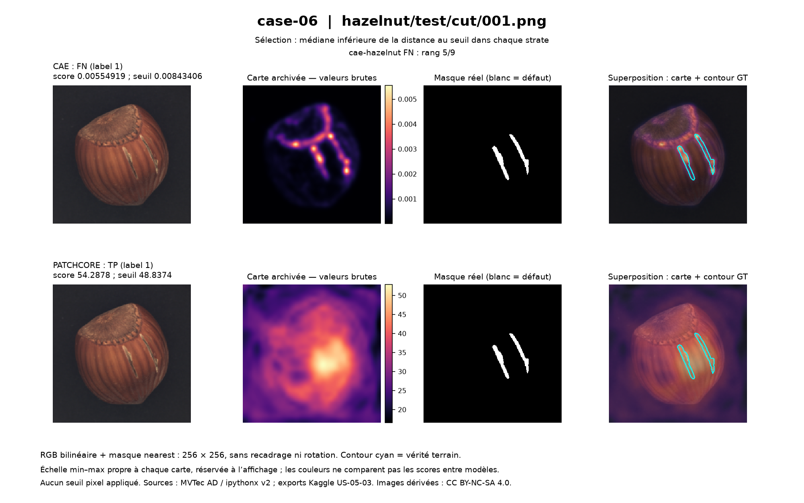

| Modèle | Verdict image | Score | Seuil figé | Marge signée | Maximum dans GT |
|---|---|---:|---:|---:|---|
| cae | FN | 0.00554918824 | 0.00843406352 | -0.00288487528 | Oui |
| patchcore | TP | 54.2877579 | 48.837368 | 5.45038986 | Oui |

Les incisions produisent une réponse dans les deux cartes. CAE est FN malgré son maximum dans le masque ; PatchCore est TP avec une réponse plus large que les incisions. La décision image et la précision géométrique d'une localisation sont deux questions distinctes.

## case-07 — `hazelnut/test/hole/001.png`

Strate : **cae-hazelnut / FN / hole**, rang 2/3 en distance au seuil.

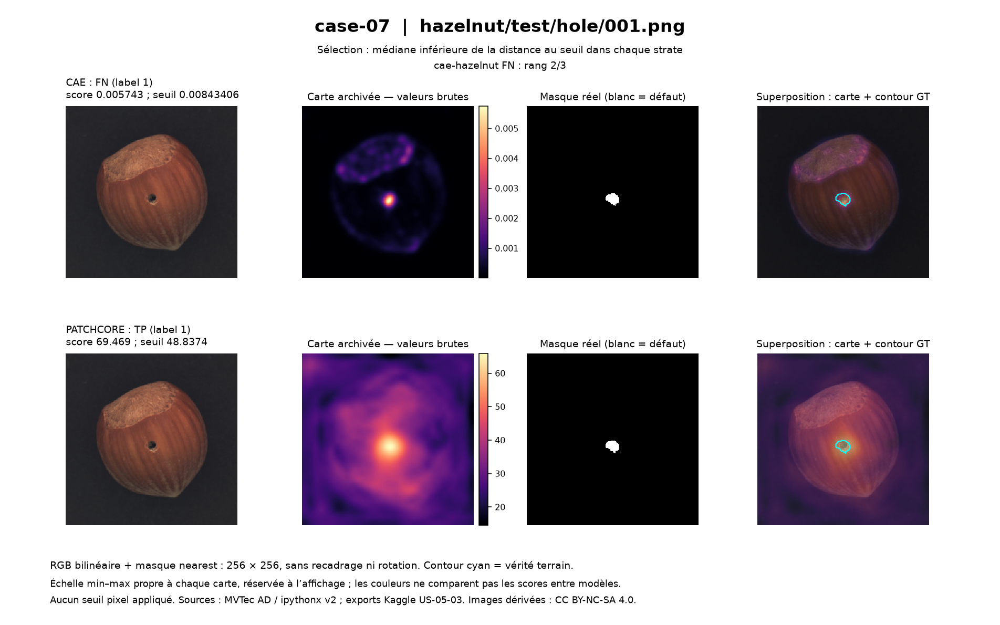

| Modèle | Verdict image | Score | Seuil figé | Marge signée | Maximum dans GT |
|---|---|---:|---:|---:|---|
| cae | FN | 0.00574300205 | 0.00843406352 | -0.00269106147 | Oui |
| patchcore | TP | 69.4689865 | 48.837368 | 20.6316185 | Oui |

Le trou n'occupe que 264 pixels sur la grille 256 × 256 (0,40 %). Les deux maxima sont dans le masque ; le CAE reste FN, PatchCore est TP. Le faible contraste absolu du score CAE relativement au seuil figé est ici observable ; une belle carte normalisée pour l'affichage ne suffit pas à décider au niveau image.

## case-08 — `transistor/test/bent_lead/008.png`

Strate : **cae-transistor / FN / bent_lead**, rang 4/7 en distance au seuil.

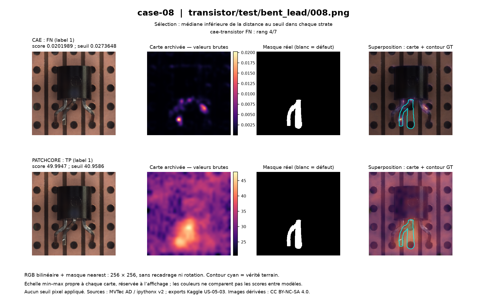

| Modèle | Verdict image | Score | Seuil figé | Marge signée | Maximum dans GT |
|---|---|---:|---:|---:|---|
| cae | FN | 0.020198863 | 0.0273647588 | -0.00716589577 | Oui |
| patchcore | TP | 49.9946785 | 40.958556 | 9.03612251 | Oui |

Le défaut de patte pliée est visible dans le RGB. Les cartes répondent autour des pattes ; les maxima des deux familles sont dans le masque. CAE demeure FN, tandis que PatchCore est TP. La réponse CAE concerne aussi d'autres zones métalliques, sans que cela autorise un comptage de faux positifs pixel.

## case-09 — `transistor/test/cut_lead/005.png`

Strate : **cae-transistor / FN / cut_lead**, rang 5/9 en distance au seuil.

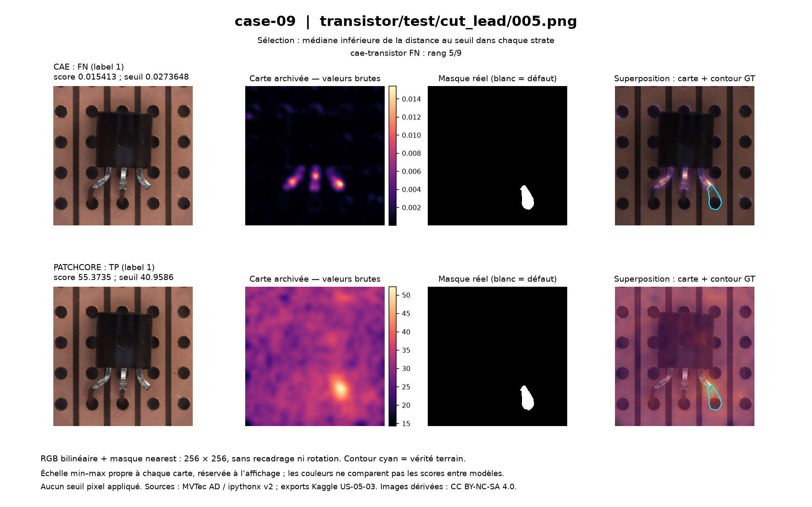

| Modèle | Verdict image | Score | Seuil figé | Marge signée | Maximum dans GT |
|---|---|---:|---:|---:|---|
| cae | FN | 0.0154130189 | 0.0273647588 | -0.0119517399 | Non |
| patchcore | TP | 55.3734932 | 40.958556 | 14.4149372 | Oui |

Sur la patte coupée, le CAE répond aux extrémités métalliques et son maximum est hors de la petite annotation. PatchCore est TP avec son maximum dans le masque. Les détails fins et le fond périodique font partie des difficultés visibles de cette catégorie.

## case-10 — `transistor/test/damaged_case/007.png`

Strate : **cae-transistor / FN / damaged_case**, rang 5/10 en distance au seuil.

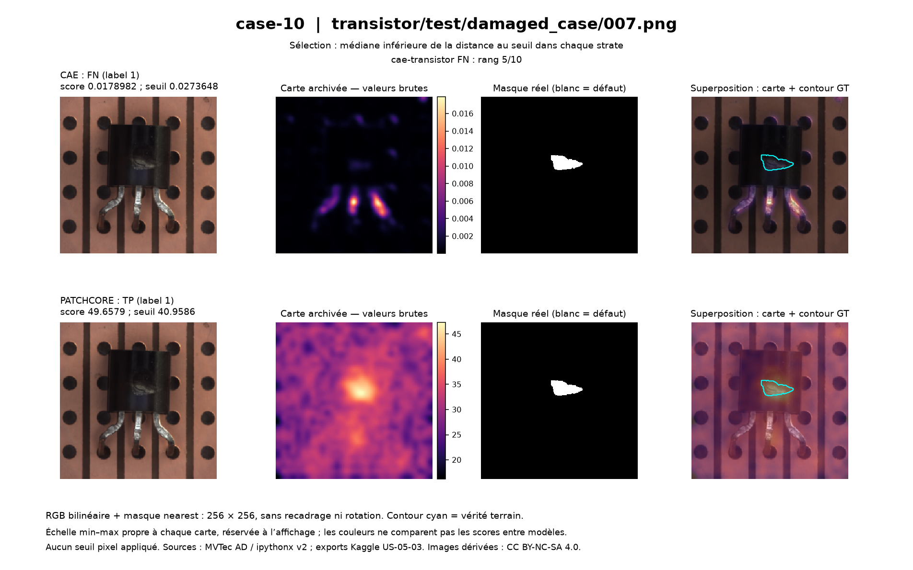

| Modèle | Verdict image | Score | Seuil figé | Marge signée | Maximum dans GT |
|---|---|---:|---:|---:|---|
| cae | FN | 0.0178982262 | 0.0273647588 | -0.00946653262 | Non |
| patchcore | TP | 49.6578636 | 40.958556 | 8.69930763 | Oui |

Le défaut annoté est sur le boîtier, mais la réponse maximale du CAE est au niveau des pattes, hors du masque. PatchCore présente une réponse sur le boîtier et classe l'image TP. Cette discordance spatiale est cohérente avec une sensibilité du CAE à d'autres contours ; elle ne permet pas de reconstruire l'image produite par le CAE, qui n'a pas été archivée.

## case-11 — `transistor/test/good/037.png`

Strate : **patchcore-transistor / FP / good**, rang 3/6 en distance au seuil.

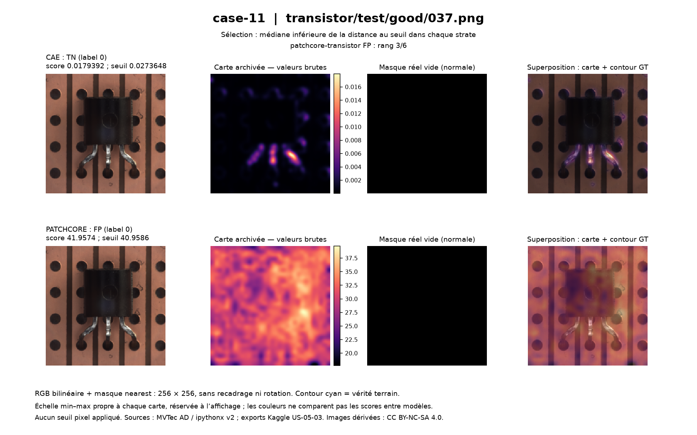

| Modèle | Verdict image | Score | Seuil figé | Marge signée | Maximum dans GT |
|---|---|---:|---:|---:|---|
| cae | TN | 0.0179392248 | 0.0273647588 | -0.00942553394 | Non applicable (normale) |
| patchcore | FP | 41.9573517 | 40.958556 | 0.9987957 | Non applicable (normale) |

Image normale : CAE est TN et PatchCore FP. La carte PatchCore présente une réponse diffuse, notamment sur le fond et les bords. Le score ne dépasse le seuil que de 0,998796. Aucune région anormale n'est ajoutée au masque pour expliquer artificiellement cette alarme.

## case-12 — `transistor/test/misplaced/000.png`

Strate : **cae-transistor / FN / misplaced**, rang 4/8 en distance au seuil.

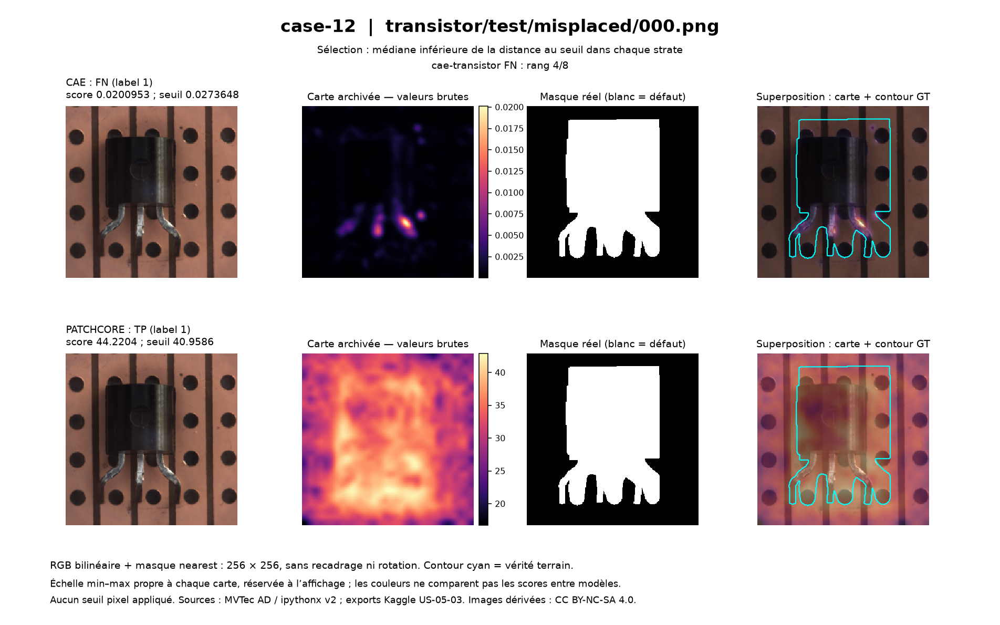

| Modèle | Verdict image | Score | Seuil figé | Marge signée | Maximum dans GT |
|---|---|---:|---:|---:|---|
| cae | FN | 0.0200953167 | 0.0273647588 | -0.00726944208 | Oui |
| patchcore | TP | 44.2203636 | 40.958556 | 3.26180763 | Oui |

Le masque de la classe misplaced couvre largement le composant et ses pattes. CAE répond surtout aux pattes et reste FN ; PatchCore est TP, avec une réponse étalée. Le maximum dans une annotation couvrant 40,35 % de l'image n'est pas une preuve suffisante de localisation précise.

## case-13 — `transistor/test/misplaced/002.png`

Strate : **patchcore-transistor / FN / misplaced**, rang 1/1 en distance au seuil.

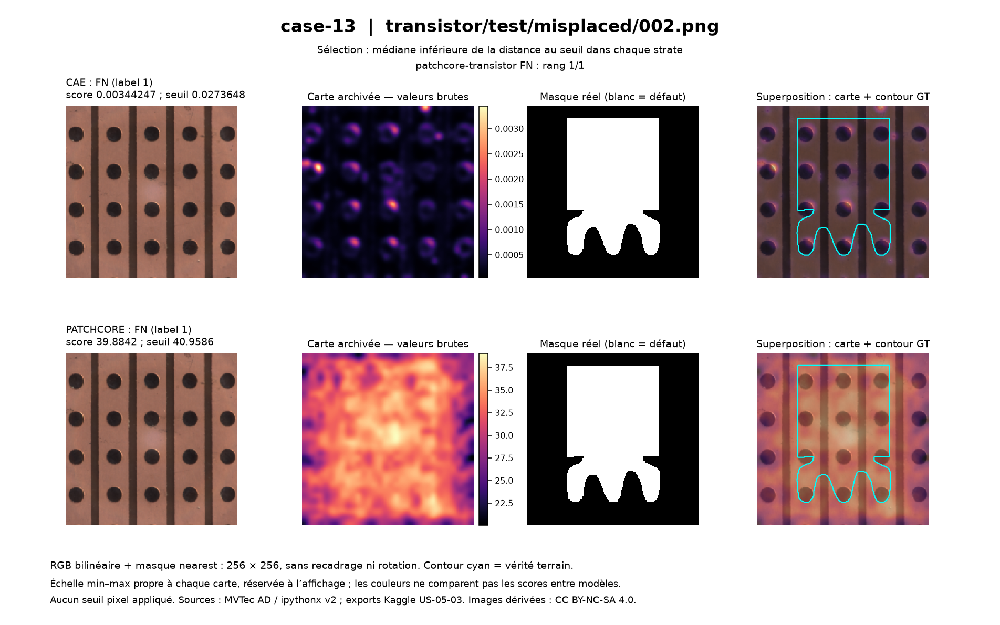

| Modèle | Verdict image | Score | Seuil figé | Marge signée | Maximum dans GT |
|---|---|---:|---:|---:|---|
| cae | FN | 0.00344247301 | 0.0273647588 | -0.0239222858 | Non |
| patchcore | FN | 39.8842239 | 40.958556 | -1.07433205 | Oui |

Le composant est absent dans le RGB, tandis que le masque officiel de la classe misplaced indique sa zone attendue. Les deux modèles sont FN. La carte CAE réagit surtout au fond périodique ; PatchCore a une réponse plus forte dans la zone annotée mais son score 39,884224 reste sous 40,958556. Une difficulté de contexte/structure globale est une hypothèse compatible avec ce cas, sans démonstration causale ni garantie qu'un changement de seuil suffirait en général.
