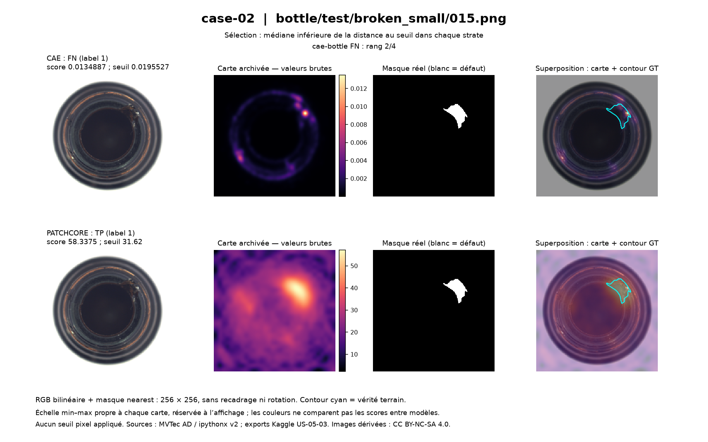
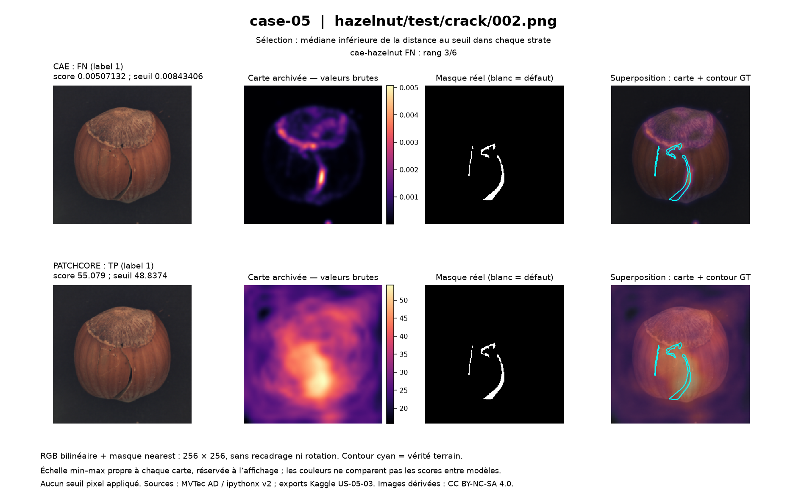
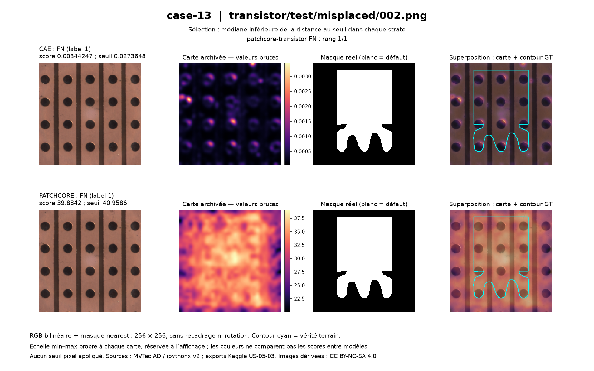

# US-05-04 — Analyse des erreurs et limites scientifiques

**Livraison technique complète au 16 novembre 2026 (UTC).** ST-05-04-01 et ST-05-04-02
disposent de leurs livrables ; les trois critères d'acceptation ci-dessous sont vérifiés.
Projet Jira **IDL**, branche `epic/05-evaluation-benchmark`. Les critères et intitulés ont été
transmis directement par l'utilisateur après correction du projet Jira ; aucune modification de
ticket n'est effectuée. La revue humaine reste distincte de cette validation technique.

**Résultat principal :** les six benchmarks contiennent **86 erreurs image/modèle : 79 FN et 7 FP**.
Une sélection déterministe donne **13 images**, chacune présentée avec les deux familles, soit
26 cartes archivées. Les RGB et masques originaux nécessaires ont été récupérés depuis MVTec AD
sur Kaggle ; les 13 planches sont vérifiées visuellement et reproductibles octet pour octet.
Les six benchmarks, les seuils, le code scientifique et le notebook EDA non indexé restent inchangés.
Aucun entraînement, aucune inférence ni recalibration n'a été lancé.

## Périmètre et références figées

- Base de travail : `feef309ee5f02907d1359c76a3ff0b81e5ced49e` ; code scientifique exécuté sur Kaggle :
  `0acbf26880b755373f2e61236d009ed16f04658c`, protocole 1.1.0.
- Les [six résultats US-05-03](us-05-03.md) couvrent 586 prédictions sur **293 images distinctes**,
  avec les mêmes chemins Test/labels/masques entre familles. Les erreurs comptent des paires
  image/modèle : elles ne sont pas 86 images distinctes.
- Sources NPZ : archives des versions Kaggle **370020172** et **370053025**, toujours conservées
  hors Git ; [provenance du premier lot](../../experiments/benchmark/kaggle-001-provenance.json) et
  [du deuxième lot](../../experiments/benchmark/kaggle-002-provenance.json).
- [Registre des seuils](../../experiments/calibration/six-thresholds/thresholds.json), ancre inchangée :
  `41dd9d26e68840ca5d104062605d967e72a2d3907937e8ed6745743034c96b6a`.
  Décision **`score > threshold`** ; l'égalité au seuil reste normale.
- CAE Bottle EXP-002 et PatchCore Hazelnut **EXP-002 corrigée** restent les références prévues ;
  aucun autre checkpoint n'est sélectionné en examinant les exemples.

## ST-05-04-01 — Inventaire exhaustif et sélection reproductible

| Instance | Test | TP | TN | FP | FN |
|---|---:|---:|---:|---:|---:|
| cae-bottle | 83 | 37 | 20 | 0 | 26 |
| cae-hazelnut | 110 | 52 | 40 | 0 | 18 |
| cae-transistor | 100 | 6 | 60 | 0 | 34 |
| patchcore-bottle | 83 | 63 | 19 | 1 | 0 |
| patchcore-hazelnut | 110 | 70 | 40 | 0 | 0 |
| patchcore-transistor | 100 | 39 | 54 | 6 | 1 |

L'[inventaire complet des 86 erreurs](../data/us-05-04/errors.csv) contient les scores, seuils exacts,
marges signées `score - threshold`, labels, indices de prédiction, chemins et empreintes NPZ.
La [synthèse par type de défaut](../data/us-05-04/error-summary.json) conserve les effectifs et les
matrices de confusion. L'absence d'erreur n'est jamais remplacée par un cas inventé :
**aucun FP CAE**, aucun FN PatchCore Bottle et **aucun FP/FN PatchCore Hazelnut**.
Les trois planches Hazelnut présentent donc des FN CAE comparés à des TP PatchCore.

La sélection est définie sans examiner les RGB ni les cartes : pour chaque strate non vide
`(instance, FP ou FN, type de défaut)`, trier les erreurs par **distance absolue au seuil**, puis
par chemin lexicographique en cas d'égalité, et retenir la **médiane inférieure** : indice
`floor((n-1)/2)`. Les marges ne sont comparées qu'au sein d'une même instance. Cette règle couvre
les 13 strates d'erreurs, y compris les classes rares ; l'unique erreur d'une strate est retenue.
Les deux familles sont ensuite associées sur le même chemin Test, avec le même RGB et le même masque.

Le [fichier de sélection](../data/us-05-04/selection.json) contient la règle, le rang et l'effectif
de chaque strate, ainsi que les deux prédictions et leurs sources exactes. Cette sélection décrit
des modes d'échec ; elle n'est ni aléatoire ni représentative des fréquences du dataset. Aucune
nouvelle métrique globale n'est estimée sur les seuls exemples sélectionnés. Le Test sert ici à
l'analyse après évaluation, pas au réglage de modèles, seuils ou hyperparamètres.

| Figure | Image Test exacte | CAE | PatchCore | Strate sélectionnée (effectif) |
|---|---|---|---|---|
| [case-01](../data/us-05-04/figures/case-01.png) | `bottle/test/broken_large/002.png` | FN | TP | cae-bottle FN / broken_large (7) |
| [case-02](../data/us-05-04/figures/case-02.png) | `bottle/test/broken_small/015.png` | FN | TP | cae-bottle FN / broken_small (4) |
| [case-03](../data/us-05-04/figures/case-03.png) | `bottle/test/contamination/016.png` | FN | TP | cae-bottle FN / contamination (15) |
| [case-04](../data/us-05-04/figures/case-04.png) | `bottle/test/good/001.png` | TN | FP | patchcore-bottle FP / good (1) |
| [case-05](../data/us-05-04/figures/case-05.png) | `hazelnut/test/crack/002.png` | FN | TP | cae-hazelnut FN / crack (6) |
| [case-06](../data/us-05-04/figures/case-06.png) | `hazelnut/test/cut/001.png` | FN | TP | cae-hazelnut FN / cut (9) |
| [case-07](../data/us-05-04/figures/case-07.png) | `hazelnut/test/hole/001.png` | FN | TP | cae-hazelnut FN / hole (3) |
| [case-08](../data/us-05-04/figures/case-08.png) | `transistor/test/bent_lead/008.png` | FN | TP | cae-transistor FN / bent_lead (7) |
| [case-09](../data/us-05-04/figures/case-09.png) | `transistor/test/cut_lead/005.png` | FN | TP | cae-transistor FN / cut_lead (9) |
| [case-10](../data/us-05-04/figures/case-10.png) | `transistor/test/damaged_case/007.png` | FN | TP | cae-transistor FN / damaged_case (10) |
| [case-11](../data/us-05-04/figures/case-11.png) | `transistor/test/good/037.png` | TN | FP | patchcore-transistor FP / good (6) |
| [case-12](../data/us-05-04/figures/case-12.png) | `transistor/test/misplaced/000.png` | FN | TP | cae-transistor FN / misplaced (8) |
| [case-13](../data/us-05-04/figures/case-13.png) | `transistor/test/misplaced/002.png` | FN | FN | patchcore-transistor FN / misplaced (1) |

### Lecture des figures et alignement

La [galerie complète légendée](us-05-04-gallery.md) contient les 13 planches, à deux lignes
(CAE / PatchCore) et quatre colonnes : **RGB original redimensionné, carte archivée, masque réel,
superposition carte/RGB avec contour du masque**. Les scores et seuils figurent sur chaque ligne.

Le RGB est converti en RGB puis redimensionné en bilinéaire à **256 × 256**. Le masque original
est converti en niveaux de gris, binarisé par `>127`, puis redimensionné au plus proche voisin,
exactement comme dans [le dataset](../../src/data/mvtec_dataset.py) et
[ses transformations](../../src/data/transforms.py). Aucun recadrage, aucune rotation ni inversion
n'est effectué. Pour une normale, le masque est nul. Chaque masque ainsi obtenu est comparé
pixel par pixel aux **deux NPZ** associés : égalité exacte pour les 13 chemins. Les cartes 256 × 256
des NPZ sont affichées sans nouveau redimensionnement scientifique ni interpolation visuelle lissante.

La palette `magma` utilise le **min–max propre à chaque carte**, annoncé dans la légende et matérialisé
par une barre de couleur en valeurs brutes. La même échelle est utilisée pour la carte seule et sa
superposition (alpha 0,42). Cette normalisation est réservée au rendu : **elle ne change ni score,
ni seuil, ni décision**, et les couleurs ne comparent pas les valeurs entre modèles ou images.
Un contour cyan représente le masque réel ; aucun contour n'est ajouté aux normales.

### Classification image et localisation pixel : deux niveaux distincts

FP/FN désigne uniquement la décision image face au label. Les cartes restent des scores spatiaux
continus : aucun seuil pixel n'a été calibré. On ne calcule donc ni FP/FN pixel, ni IoU/Dice binaire,
et le seuil image n'est jamais appliqué à la carte pour fabriquer une segmentation.
Les [diagnostics descriptifs](../data/us-05-04/spatial-diagnostics.json) indiquent surface du masque,
position du maximum et moyennes intérieure/extérieure. Ces observations locales ne remplacent
ni une métrique de segmentation ni une évaluation complète. Pour un masque vide, les statistiques
intérieures et « maximum dans le masque » valent explicitement `null`.

Le CAE de `case-02`, `case-05` et `case-07` est FN alors que son maximum spatial est dans le masque.
Inversement, PatchCore est TP dans `case-05` avec un maximum juste hors de l'annotation fine.
Une bonne décision image ne garantit donc pas une frontière précise, et une réponse locale visible
n'implique pas que le seuil image soit franchi. Les Pixel-AUROC publiés dans US-05-03 sont conservés
sans recalcul ; ils ne constituent pas des scores de segmentation à seuil fixe.

## ST-05-04-02 — Interprétation par catégorie

### Bottle : contamination, cassures et réponses périphériques

CAE manque **15/21 contaminations**, **7/20 grandes cassures** et **4/22 petites cassures**.
Il n'a aucun FP parmi les 20 normales. PatchCore détecte les 63 anomalies, avec un FP sur 20 normales.
Sur `case-01` et `case-03`, le maximum CAE est sur un contour hors du masque, tandis que PatchCore
répond sur la région annotée. Sur la petite cassure `case-02`, CAE répond au défaut mais reste FN.
L'échec CAE n'est donc pas réductible à une absence uniforme de localisation.

**Figure Bottle — `bottle/test/broken_small/015.png`.** Maxima des deux cartes dans le masque ;
score CAE 0,013489 sous 0,019553, score PatchCore 58,337509 au-dessus de 31,620044.
La cassure couvre 1,66 % de la grille. Ce cas sépare réponse spatiale et décision image.

Le [FP Bottle `case-04`](../data/us-05-04/figures/case-04.png) est une image normale, pas un défaut
« découvert » par la carte. Son score PatchCore vaut 32,888393 pour un seuil 31,620044 ; le maximum
de la carte redimensionnée vaut seulement 30,823715. Le `pred_score` natif et ce maximum sont donc
distincts. Les reflets, les contours et la variabilité d'apparence du verre peuvent contribuer aux
réponses observées ; ces causes restent des hypothèses sans expérimentation contrôlée.

### Hazelnut : réponse sur les défauts fins malgré des FN image

CAE manque **6/18 fissures**, **9/17 coupures** et **3/18 trous**, mais détecte les **17/17 print**.
PatchCore EXP-002 détecte les 70 anomalies et ne signale aucune des 40 normales. Aucun exemple
« d'erreur PatchCore Hazelnut » n'est fabriqué. Sur les trois cas sélectionnés, CAE produit une
réponse au défaut insuffisante pour dépasser le seuil ; il répond aussi à la texture et au bord
supérieur de la noisette. Les cartes PatchCore sont plus diffuses autour de la zone anormale.

**Figure Hazelnut — `hazelnut/test/crack/002.png`.** CAE : 0,005071 < 0,008434 malgré un maximum
dans la fissure ; PatchCore : 55,078957 > 48,837368, avec un maximum juste hors du masque.
La carte large ne reproduit pas exactement les frontières. Dans `case-07`, le trou ne représente
que **264 pixels (0,40 %)** ; les détails fins sont sensibles à la grille d'évaluation et à l'annotation.
Cela ne prouve pas que les masques sont incorrects : ils sont utilisés tels que fournis.

### Transistor : défauts fins, géométrie et absence du composant

CAE manque **7/10 bent_lead**, **9/10 cut_lead**, **10/10 damaged_case** et **8/10 misplaced**,
sans FP parmi les 60 normales. Sa précision de 1,0 repose sur seulement six alertes correctes,
avec un rappel de 0,15. PatchCore détecte 39/40 anomalies, mais produit 6 FP parmi les 60 normales.
Les pattes métalliques, le fond périodique et les variations de position sont visibles dans les RGB.

Dans [case-10](../data/us-05-04/figures/case-10.png), CAE réagit surtout aux pattes alors que le masque
désigne le boîtier ; PatchCore réagit sur le boîtier et est TP. Le
[FP normal `case-11`](../data/us-05-04/figures/case-11.png) montre une réponse PatchCore diffuse et
un dépassement du seuil de 0,998796. Cette image n'a pas de région défectueuse annotée.

**Figure Transistor — `transistor/test/misplaced/002.png`.** Le composant est absent ; le masque
officiel marque la zone attendue, représentant 37,97 % de la grille. CAE est FN à 0,003442 contre
0,027365, PatchCore FN à 39,884224 contre 40,958556. Le maximum CAE est hors du masque ; celui
de PatchCore est dedans, sans franchissement du seuil image. Le fond local peut rester familier
alors que la structure globale est anormale : c'est une hypothèse compatible avec ce cas, non
une démonstration du mécanisme interne. Le système ne garantit donc pas la détection d'une absence.

## Reconstruction CAE et distances PatchCore

Le [CAE](../../src/inference/cae_inference.py) est entraîné à reconstruire les normales. Dans le
protocole exécuté, la carte est l'erreur quadratique de reconstruction moyennée sur les canaux,
lissée avec sigma 4 et noyau 33 ; le score image est son maximum. L'hypothèse qu'un défaut sera
mal reconstruit peut échouer : une anomalie peut être reconstructible ou produire une erreur trop
faible face aux variations normales. À l'inverse, un contour ou un reflet normal peut produire une
réponse élevée. Les cartes observées sont compatibles avec ces possibilités ; les reconstructions
RGB ne sont pas dans les exports audités, donc aucune reconstruction n'est simulée ni présentée.

PatchCore compare des représentations locales à une banque de représentations normales, selon le
principe de [Roth et al., CVPR 2022](https://arxiv.org/abs/2106.08265v2). Les configurations locales
utilisent `wide_resnet50_2`, `layer2/layer3` et `num_neighbors=1`. Le pipeline conserve le
[`pred_score` natif](../../src/inference/patchcore_inference.py) et la carte correspondante. Une
anomalie qui s'écarte des motifs normaux peut être détectée sans reconstruction explicite ; une
variation normale insuffisamment couverte par la banque peut aussi déclencher une alarme.
Les caractéristiques locales, leur résolution et le redimensionnement sont compatibles avec les
cartes plus larges observées, sans prouver que l'un de ces facteurs explique seul un échec.

Les deux scores ne partagent pas d'unité, ne sont pas des probabilités et ne sont pas comparés
numériquement entre familles. Les banques mémoire, architectures et prétraitements sont propres
aux modèles ; ce benchmark n'isole pas causalement l'effet de chaque choix architectural.

## Seuils figés et compromis précision/rappel

US-05-02 fixe un quantile **0,95 linéaire** sur les seules normales Validation : 42 Bottle,
78 Hazelnut et 43 Transistor par famille. Cette politique commune évite de rechercher un seuil
optimal sur les anomalies Test. Elle ne maximise ni F1 ni rappel et ne garantit pas 5 % de FP sur
de nouvelles normales : PatchCore obtient ici 1/20, 0/40 et 6/60 FP selon la catégorie.
Les petits effectifs, les distributions de scores et une éventuelle dérive de données limitent
la stabilité de ce seuil. La Validation a aussi servi à sélectionner certains checkpoints CAE ;
sa réutilisation pour calibrer n'apporte pas un échantillon indépendant supplémentaire.

Le CAE sans FP mais avec 78 FN illustre un compromis défavorable au rappel dans ce Test. Baisser
un seuil augmente ou maintient le nombre d'alertes sur un ensemble de scores donné, mais peut aussi
ajouter des FP. Aucun seuil alternatif, courbe d'optimisation ou seuil pixel n'est choisi ici.
Les cas proches du seuil ne servent pas à recalibrer ; ils rendent le compromis observable.

## Synthèse comparative et choix de modèle

Les valeurs suivantes reprennent les [macros US-05-03](../../experiments/benchmark/summary.json),
moyennes **non pondérées des trois catégories**. Le F1 est moyenné directement, et la latence est
la moyenne des trois latences moyennes ; ce ne sont pas des micro-moyennes.

| Famille | Image-AUROC | Pixel-AUROC | Précision | Rappel | F1 | Latence moyenne macro |
|---|---:|---:|---:|---:|---:|---:|
| CAE | 0,807553 | 0,810604 | 1,000000 | 0,493386 | 0,617776 | 19,57 ms |
| PatchCore | 0,996944 | 0,976739 | 0,950347 | 0,991667 | 0,969924 | 28,16 ms |

**Choix proposé pour l'intégration du prototype : PatchCore**, lorsque manquer un défaut est
prioritaire et qu'une Tesla T4 ainsi que la banque mémoire sont disponibles. Il manque une anomalie
contre 78 pour CAE, améliore le F1 macro de 35,21 points et le Pixel-AUROC de 16,61 points. Le coût
observé est de sept FP contre zéro, et **8,59 ms supplémentaires**, soit environ 1,44× la latence CAE.
Le coût opérationnel de ces alarmes doit rester explicite. CAE demeure plus rapide sur ces mesures,
mais ce seul avantage ne compense pas son faible rappel Transistor si l'objectif est de manquer peu
de défauts. Aucune latence CPU ni consommation mémoire comparative n'a été mesurée ici.

Cette recommandation s'appuie sur la comparaison finale de références fixées avant Test, sans
itération de réglage sur ce Test. Elle n'est pas une validation industrielle : l'absence du composant
manquée par les deux modèles, les FP et la variabilité non mesurée doivent être réévalués sur des
données indépendantes avant un déploiement réel. Aucun résultat externe n'est promis.

## Limites méthodologiques

1. **Périmètre :** trois catégories MVTec AD, 293 images distinctes, classes de défaut et proportions
   particulières. Les deux familles voient les mêmes images ; leurs 586 prédictions ne sont pas
   586 observations indépendantes. Les 13 cas sont stratifiés parmi les erreurs, sans portée statistique.
2. **Une exécution :** une seed déclarée 42, un checkpoint par instance, deux sessions Kaggle Tesla T4.
   Pas de répétition, intervalle de confiance, variance inter-runs ni test de significativité.
3. **Ressources :** latence batch 1 synchronisée CUDA, limitée à l'inférence, excluant I/O,
   prétraitement et transferts. Les images du même run ne mesurent pas la variabilité entre sessions ;
   les chiffres ne se transposent pas directement au CPU, à un autre GPU ou au débit de bout en bout.
4. **Masques et résolution :** annotations de référence, bordures fines et sémantique d'une région
   attendue en cas d'absence. Le nearest préserve les labels binaires mais peut perdre des détails
   à 256 × 256. Le fond domine souvent le nombre de pixels ; un bon Pixel-AUROC ne garantit pas
   une frontière correcte. Aucun audit indépendant de la qualité des annotations n'a été réalisé.
5. **Interprétation :** les cartes ne sont pas des explications causales. Les hypothèses sur reflets,
   texture, contexte et banque normale restent à tester ; les images reconstruites CAE manquent.
6. **Provenance RGB :** les exports US-05-03 ne contiennent pas les SHA des RGB d'entrée historiques.
   Les chemins du même dataset versionné, labels, catégories et masques correspondants sont vérifiés,
   et les octets RGB récupérés sont désormais épinglés. L'identité binaire avec chaque RGB historique
   ne peut pas être prouvée indépendamment à partir des seuls exports. Cette limite est conservée
   dans la provenance ; aucune identité cryptographique antérieure n'est inventée.

## Sources, conservation et reproduction

Les recherches locales n'ont pas trouvé les fichiers originaux correspondants. Seuls **24 PNG**
(13 RGB + 11 masques, **13 734 107 octets**) ont été téléchargés depuis
[ipythonx/mvtec-ad, version 2](https://www.kaggle.com/datasets/ipythonx/mvtec-ad/versions/2),
datée du 20 février 2022. Kaggle a servi certains PNG dans un ZIP individuel ; seul le PNG attendu
a été lu en mémoire et conservé sans modification. Pas d'authentification nécessaire pour ces fichiers.

La [provenance source](../data/us-05-04/source-images.json) fixe chaque URL versionnée, chemin,
taille, dimensions, SHA-256 du PNG et des pixels décodés. Les originaux sont conservés hors Git dans
`C:\Users\marwa\Documents\ChatGPT\Projet DeepLearning\us0504-work\mvtec-ad-v2`.
Les 13 figures dérivées font **8 374 373 octets** au total ; les gros NPZ et les ZIP restent externes.
Le [manifeste des figures](../data/us-05-04/figures-manifest.json) lie les fichiers aux sélections,
à la provenance et aux versions du moteur de rendu. Le [guide des artefacts](../data/us-05-04/README.md)
fournit les commandes reproductibles et les conditions de conservation.

**Attribution :** MVTec AD, Paul Bergmann, Michael Fauser, David Sattlegger et Carsten Steger,
MVTec Software GmbH, CVPR 2019 ; redistribution Kaggle par ipythonx. Les données et figures dérivées
sont soumises à [CC BY-NC-SA 4.0](https://creativecommons.org/licenses/by-nc-sa/4.0/), selon la
[source officielle MVTec](https://www.mvtec.com/research-teaching/datasets/mvtec-ad). Modifications
visuelles : redimensionnement, colormap, superposition et légendes, sans retouche du contenu original.

## Validation et critères d'acceptation IDL

**27 nouveaux tests réussis** : classification stricte et égalité au seuil, couverture de toutes
les strates, médiane déterministe, appariement, refus des chemins/ZIP dangereux, provenance,
absence de décisions pixel inventées et égalité exacte des masques pour les 13 paires.
**323 tests et 2 sous-tests réussis** (23,22 s) sur l'évaluation et le pipeline de données, avec
les deux ZIP et les sources RGB/GT disponibles ; aucun test ignoré. Les tests de modèles existants
utilisent des données factices et ne relancent aucun benchmark MVTec.
Les 13 figures ont été examinées visuellement ; leur régénération dans un dossier temporaire
reproduit les octets de tous les PNG et diagnostics. Liens locaux et périmètre Git sont contrôlés.

| Critère fourni par l'utilisateur (projet IDL) | Preuve | État technique |
|---|---|---|
| Exemples représentatifs de FP/FN et superpositions cartes/masques sur les trois catégories | 86 erreurs inventoriées, 13 strates sélectionnées, 13 RGB + GT vérifiés, galerie de 26 cartes | Satisfait |
| Analyse reconstruction CAE / distances PatchCore, limites des seuils et difficultés des catégories | Sections par catégorie, cas où décision et localisation divergent, mécanismes et seuils figés discutés | Satisfait |
| Synthèse comparative, méthodologie et limites intégrées à la documentation | Présente fiche, galerie, sources, scripts, tests, README et index EPIC-05 | Satisfait |

**ST-05-04-01 et ST-05-04-02 terminées techniquement ; US-05-04 clôturable techniquement.**
La revue par un autre contributeur, la transition de statut Jira et l'intégration à `main` ne sont
pas revendiquées. Aucun changement du notebook EDA, des seuils ou des benchmarks ; staging ciblé,
commits Conventional Commits et push sur la seule branche Epic, sans PR ni merge.
