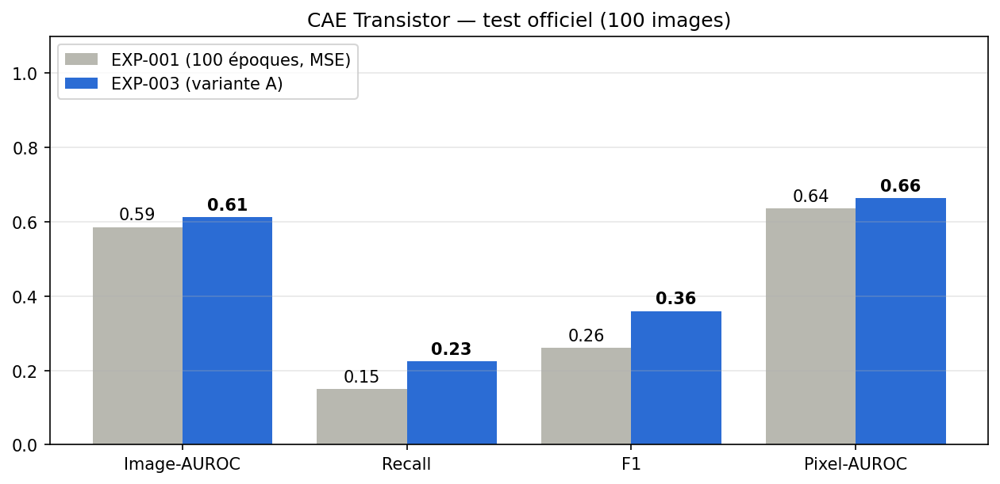

# CAE Transistor EXP-003 — entraînement amélioré (expérience complémentaire)

**Projet :** IndustrialDefect AI · EPIC-03 / EPIC-05 · suite de l'EXP-002 de Mouad
**Exécution :** Kaggle, GPU T4 x2, 1 h 11 min · [version 370459123](https://www.kaggle.com/code/zakariaelbergui/06-cae-transistor-exp003-ipynb?scriptVersionId=370459123)
**Notebook :** `notebooks/06-cae-transistor-exp003.ipynb` · **Fiche :** `experiments/runs/cae-transistor/EXP-003.json`

## Pourquoi cette expérience

Le benchmark US-05-03 a montré que **CAE Transistor EXP-001** détecte peu de défauts
(recall 0,15, Image-AUROC 0,586). EXP-001 n'avait été entraîné que 100 époques, sans
learning rate adaptatif ni early stopping. La question : la faiblesse vient-elle de
l'**entraînement** ou de la **méthode** ?

## Protocole (fixé avant l'exécution)

Deux variantes entraînées dans les mêmes conditions que l'EXP-002 de Mouad
(300 époques max, Adam lr 0,001, `ReduceLROnPlateau`, early stopping patience 40, seed 42) :

| Variante | Perte |
|---|---|
| A | MSE (EXP-002 de Mouad) |
| B | MSE + 0,5 × (1 − SSIM) |

- **Même architecture et même score que l'application** (`CAEInference` : carte MSE,
  lissage σ = 4, maximum) : le checkpoint reste compatible avec le registre.
- **Sélection sur la Validation uniquement** : AUROC entre les 43 normales de validation
  et 43 copies avec défauts synthétiques (cutpaste, noise, erase ; seed 2026), évaluée
  toutes les 5 époques.
- **Seuil** : quantile 0,95 linéaire des normales de validation, règle `score > seuil`
  (protocole US-05-02).
- **Test officiel** : chargé une seule fois, à la fin.

## Résultats

**Sélection (validation).** Variante **A** retenue : AUROC synthétique 0,693 (époque 240)
contre 0,686 pour B (époque 275). Les deux variantes ont atteint 300 époques sans early stopping.
Seuil calibré : **0,018426**.

**Test officiel (100 images : 60 normales, 40 défauts).**

| Métrique | EXP-001 (US-05-03) | EXP-003 (variante A) |
|---|---|---|
| Image-AUROC | 0,586 | **0,612** |
| Recall | 0,150 (6/40) | **0,225 (9/40)** |
| Precision | 1,00 | 0,90 (1 fausse alerte / 60) |
| F1 | 0,261 | **0,360** |
| Pixel-AUROC | 0,636 | **0,664** |

**Par type de défaut (détectés / 10).**

| Type | EXP-001 | EXP-003 |
|---|---|---|
| bent_lead | 3 | 3 |
| cut_lead | 1 | 1 |
| damaged_case | 0 | 0 |
| misplaced | 2 | **5** |

## Interprétation

1. Un entraînement plus long et mieux réglé **améliore un peu** le CAE : +3 défauts détectés,
   tous de type **misplaced**. Les défauts fins (pattes pliées ou coupées) et les boîtiers
   abîmés restent invisibles pour lui.
2. La perte **SSIM** n'a pas apporté de gain sur la validation : elle n'a pas été retenue.
3. Avec une Image-AUROC de 0,61, le CAE reste très loin de **PatchCore Transistor (0,99)**.
   La limite vient principalement de la **méthode par reconstruction** sur cet objet structuré,
   et non d'un manque d'entraînement. Cela confirme le choix de PatchCore pour l'application.

## Limites et statut

- Expérience **décidée après** le benchmark US-05-03 : le benchmark officiel conserve EXP-001 ;
  EXP-003 est rapportée **à côté**, comme étude complémentaire.
- Une seule exécution, 40 défauts au test : l'écart (+3 détections) reste dans l'ordre de
  grandeur de la variabilité possible.
- Le seuil de 0,95 garde son comportement attendu (1 fausse alerte sur 60 normales au test).
- Le checkpoint (`cae_model.pt`, SHA-256 `b7c06c22…07da132`) n'est pas versionné dans Git ;
  il est disponible dans l'Output Kaggle. Il peut être ajouté à l'application comme version
  `exp-003` (même format et même score), sans remplacer EXP-001.
